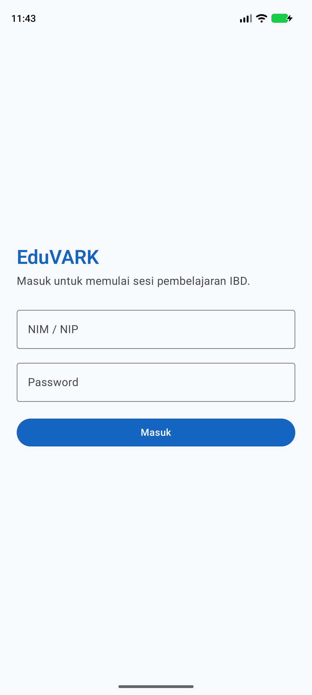

# Acceptance Matrix — EduVARK v0.7 (Fase 8)

**Tanggal:** 20 November 2026  
**Lingkungan:** PostgreSQL disposable, Node 24, Android emulator Pixel 10 Pro XL (API 37).  
**Status:** 13/13 gate AT-P lulus dengan bukti eksekusi otomatis.

## 1. Ringkasan bukti

| Suite | Jumlah | Hasil |
|---|---|---|
| Backend Vitest | 74 test (13 file) | Lulus |
| Android unit test | 22 test | Lulus |
| Android instrumented test | 2 test | Lulus di emulator API 37 |
| DDL apply + material update | 1 skenario tambahan | Lulus (MATERIAL_UPDATED_AT_OK) |
| npm audit --omit=dev | 0 vulnerability | Lulus |
| App launch smoke test | Login screen tampil, tidak ada crash | Lulus |

## 2. Gate AT-P01–AT-P13

| Gate | Bukti otomatis | Status |
|---|---|---|
| AT-P01 | auth.test.ts: kredensial salah 401, akun nonaktif 403, login aktif 200 | **PASS** |
| AT-P02 | topics.test.ts, admin.test.ts, assessments.test.ts: RBAC tiga role + kelas lain | **PASS** |
| AT-P03 | topics.test.ts: 3 topik, reorder, publish tanpa materi, arsip, guard data akademik | **PASS** |
| AT-P04 | topics.test.ts: PDF valid, MIME palsu, file tidak ada, upload melebihi batas 413 | **PASS** |
| AT-P05 | feedback.test.ts: -1/101, Kinesthetic 403, tanpa VARK, materi kosong | **PASS** |
| AT-P06 | cases.test.ts: deadline UTC + WIB, update sebelum submit, lock setelah submit, audit | **PASS** |
| AT-P07 | assessments.test.ts: pemilik, mahasiswa lain, dosen lain, admin | **PASS** |
| AT-P08 | analytics.test.ts: n/mean/histogram, belum feedback terpisah, Kinesthetic terpisah | **PASS** |
| AT-P09 | admin.test.ts: buat akun, duplikat, role invalid, update role, nonaktif, last-admin | **PASS** |
| AT-P10 | assessment-rollback.test.ts: audit gagal → 500, assessment 0, teks submission tetap | **PASS** |
| AT-P11 | auth.test.ts: login dosen/admin, logout, sesi lama 401 | **PASS** |
| AT-P12 | topics.test.ts: materi dihapus → request baru 404, feedback tetap, signed URL lama tetap ada | **PASS (storage mock)** |
| AT-P13 | auth.test.ts + admin.test.ts: password sementara, reset admin, sesi lama dicabut | **PASS** |

## 3. Catatan bukti

- **AT-P04:** batas upload diuji dengan MAX_UPLOAD_BYTES=1 MB dan file 2 MB; produksi memakai default 100 MB. Kode kini membaca env, bukan hardcode.
- **AT-P10:** kegagalan audit disimulasikan lewat mock; transaksi PostgreSQL diuji rollback.
- **AT-P12:** R2 memakai mock; TTL signed URL nyata belum diuji karena kredensial R2 tidak tersedia.
- **AT-P08:** query agregasi server-side; klien hanya menampilkan.
- **AT-P11:** sesi kedua mencabut sesi pertama; logout mengembalikan 204.
- **AT-P13:** reset password mencabut sesi lama; akses akademik diblokir sampai ganti password.

## 4. Regression dan QA

- npm run typecheck, npm run lint, npm test, npm run build: lulus.
- ./gradlew assembleDebug testDebugUnitTest lintDebug assembleDebugAndroidTest: lulus.
- ./gradlew connectedDebugAndroidTest: 2/2 lulus di emulator API 37.
- APK debug diinstal dan dibuka; login screen tampil tanpa crash.

- DDL draft di-apply ulang setelah kolom materials.updated_at ditambahkan; update materi lulus.
- npm audit --omit=dev: 0 vulnerability.

## 5. Batasan yang tersisa

- R2/MinIO nyata belum diuji; upload memakai mock.
- Target performa OQ-05 masih TBD; belum ada load test 100 pengguna.
- Release API base URL masih placeholder (https://api.eduvark.example); signing/play distribution belum.
- Belum ada uji E2E penuh aplikasi ↔ backend nyata di perangkat.
- Instrumented UI test masih terbatas pada login screen.
