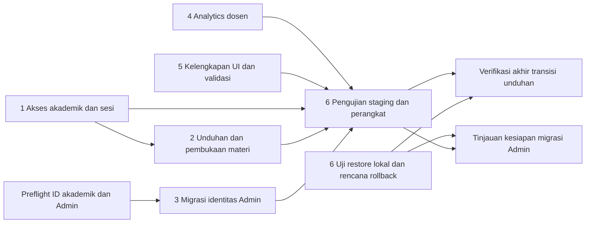

# Analisis Kesenjangan SRS dan Codebase EduVARK

**Status laporan** siap ditinjau Project Owner.

**Tanggal baseline** 24 November 2026.

**Tahap C dan C.1.** Laporan ini mencatat kondisi awal, keputusan klarifikasi, dan kriteria penerimaan untuk pekerjaan berikutnya.

## Ringkasan

Inspeksi source menghasilkan **36 ALIGNED** dan **14 PARTIALLY IMPLEMENTED** dari 50 Functional Requirements. Jumlah **NOT IMPLEMENTED**, **IMPLEMENTED DIFFERENTLY**, dan **NEEDS VERIFICATION** pada matriks FR masing-masing 0. Keputusan Tahap C.1 memperjelas target dan rencana verifikasi. Status implementasi tetap mengikuti snapshot yang diaudit.

Prioritas pertama adalah menutup akses akademik saat ganti password wajib dan menegakkan enrollment aktif pada detail jawaban mahasiswa. Jalur unduh tetap mengikuti penjagaan sesi dan izin itu. Persiapan migrasi Admin bisa berjalan paralel dengan pemeriksaan benturan ID. Perbaikan Analytics, topik, dan validasi input dapat diverifikasi secara terpisah. Status runtime untuk build, acceptance, kondisi produksi, dan restore belum tersedia.

## 1. Baseline SRS dan kode

| Artefak | Identitas yang diperiksa |
|---|---|
| SRS SSOT | [Dokumen-SRS.docx](../../Dokumen-SRS.docx), SRS-EDUVARK-007 v0.7, revisi 24 November 2026. SHA-256 `a4bdc18928e0be3ba48cf868ecaa919bed6ab72a81cc17696754a39e0dcbe907`. |
| Git | `fix/eduvark-functional-audit-2026`, HEAD `b7b6cd6d2be19c1f0aa93f2b95454049984250d5`. Inspeksi juga mencakup perubahan lokal Android. |
| Fingerprint aplikasi | SHA-256 diff biner HEAD untuk `app backend .github` adalah `50515a3976d46061d409fcc40e58c9e555bdb8c352a115301a66e5012ec55c8e`. SHA-256 daftar checksum file untracked pada cakupan yang sama adalah `8cadc861129aac480fcb5c4e3ccf27c4a1b403f200c0ce0a5310507ccca28a40`. |
| Keterlacakan | [RTM SRS](../srs/REQUIREMENTS_TRACEABILITY_MATRIX.md) memuat 50 FR, 19 BR, 35 AT, dan 110 pasangan FR ↔ AT. Gunakan RTM tersebut untuk hubungan normatif. Gunakan matriks di laporan ini untuk status audit Tahap C. |
| Keputusan SRS | [DEC-001–DEC-011](../DECISIONS.md#register-keputusan-srs). Register di bawah mencatat klarifikasi Tahap C.1 dan kesiapan operasional. |
| Bukti | Inspeksi Android, API, SQL, konfigurasi, dependency terkunci, dan kode pengujian. [Catatan AT-P](../acceptance/ACCEPTANCE_MATRIX.md) memberi bukti historis untuk skenario lama. Tahap ini belum menjalankan tes aplikasi, mengakses kredensial produksi, atau membaca data produksi. |

## 2. Decision register Tahap C.1

| ID | Jenis | Status | Keputusan dan implikasi | Keterlacakan |
|---|---|---|---|---|
| C1-01 | BUSINESS DECISION | APPROVED | Lewati nomor kandidat Admin yang sudah dipakai. Pertahankan NIM/NIDN pengguna yang ada. Alokasi tetap memakai format `014014` + lima digit, memakai nomor urut mulai `00001`, dan boleh memiliki celah. Pertahankan UUID dan riwayat akun Admin lama. | DEC-006, FR-001/034/036, AT-25/28 |
| C1-02 | TECHNICAL DECISION, didelegasikan pemilik proyek | DITETAPKAN | Hentikan seluruh penerbitan URL berkas lama, gunakan kedaluwarsa alami untuk URL yang sudah terbit, dan hitung jendela peralihan dari penerbitan terakhir berdasarkan TTL maksimum yang terbukti. Jalur unduh baru menerapkan otorisasi sejak dibuka. Peralihan selesai setelah verifikasi URL lama tidak lagi memberi isi berkas. | DEC-001/004, FR-007/015, AT-01/03/18–22/26/32 |
| C1-03 | BUSINESS DECISION dan DOCUMENTATION ISSUE | APPROVED | Uji teks persis FR-016 pada UI locale Indonesia. UI Inggris tetap memakai terjemahan setara. Terapkan keadaan materi kosong pada Kinesthetic sambil mempertahankan akses ke kasus yang tersedia. Bedakan keadaan kosong dari kegagalan memuat. | FR-016, BR-08, AT-04 |
| C1-04 | TECHNICAL DECISION | APPROVED | Hitung 1–10.000 *code point* Unicode setelah membuang spasi di awal dan akhir, mengikuti layanan backend. Penghitung Android dan validasi API mengikuti satuan serta urutan normalisasi yang sama. Backend tetap memutuskan penerimaan kiriman. | FR-024/038/047/050, BR-17, AT-15 |
| C1-05 | BUSINESS DECISION | APPROVED | Pertahankan cakupan Analytics. Tampilkan jumlah responden, bedakan 0% dari belum memberi feedback, dan hitung jumlah serta rerata seluruh nilai final Kinesthetic. Pertahankan `notRespondedCount` dan `notSubmittedCount` sebagai field kompatibilitas API, dengan definisi yang mengikuti enrollment dan sesi aktif. Keduanya berada di luar kriteria metrik resmi dosen. | DEC-003/011, FR-029–033/048, AT-05/17/24/34 |
| C1-06 | BUSINESS DECISION | APPROVED | Gunakan OQ-05 sebagai tolok ukur awal staging. p95 baca < 2 detik, p95 tulis < 3 detik, dan 100 pengguna serentak untuk profil beban yang tercatat. Ukur media secara terpisah. Tetapkan SLO setelah hasil pengukuran tersedia. Tolok ukur ini menjadi referensi pengukuran, dengan keputusan rilis tetap pada pemilik proyek. | §5.1, §5.4, [OQ-05](../srs/OPEN_QUESTIONS.md#oq-05--target-performa-dan-kapasitas) |
| C1-07 | BUSINESS DECISION dan RUNTIME VERIFICATION | APPROVED untuk cakupan backup | Backup offsite berada di luar cakupan roadmap ini. Gunakan cadangan lokal PostgreSQL yang tersedia. Rekomendasi teknis untuk perubahan data berisiko adalah memulihkan dump lokal ke lingkungan terisolasi dan memeriksa data, alur aplikasi, serta konsistensi referensi berkas. Bukti restore dan ukuran kehilangan data/waktu pulih masih terbuka. | Appendix C, [OQ-03](../srs/OPEN_QUESTIONS.md#oq-03--backup-dr-dan-purge), Paket 6 |

**Catatan konsistensi SRS.** C1-03 memperjelas locale AT-04. C1-04 memperjelas satuan karakter yang belum dinyatakan. C1-07 membatasi cakupan roadmap sementara Appendix C tetap mencatat backup offsite sebagai pekerjaan terbuka pada saat dokumen dibuat. Target normatif FR-015 setelah transisi tetap berlaku penuh. SRS final tetap menjadi acuan.

## 3. Peta paket dan dependensi

| Paket | Prioritas | Lingkup hasil | Dependensi untuk mulai atau rilis |
|---|---|---|---|
| 1. Akses akademik dan sesi | P1 | Guard ganti password, respons autentikasi Android, dan akses detail menurut enrollment. | Kontrak guard dibutuhkan Paket 2. |
| 2. Unduhan dan pembukaan materi | P1 | Alamat tetap, evaluasi izin per permintaan, pembukaan tautan melalui EduVARK, transisi URL lama. | Gunakan guard Paket 1. Uji staging dan tinjau risiko storage bersama Paket 6 sebelum peralihan. |
| 3. Migrasi identitas Admin | P1 | Alokasi, backfill, login Android/API, reset/seed/role dan pencabutan sesi konsisten. | Preflight data dapat berjalan paralel. Peralihan produksi menunggu kesiapan klien, rollback, dan uji restore Paket 6. |
| 4. Analytics dosen | P2 | Filter feedback berdasarkan kategori asal dan agregat semua nilai final. | Skema sudah memiliki sumber data. Uji kontrak API dan UI bersama. |
| 5. Kelengkapan UI dan validasi input | P2/P3 | Edit/reorder topik, keadaan materi kosong, validasi nilai, penghitung jawaban. | Pakai API edit yang ada. Jalankan regresi setelah kontrak daftar materi Paket 2 stabil jika layar disentuh bersamaan. |
| 6. Verifikasi runtime dan kesiapan perubahan | Lintas paket | Matriks pengujian, tolok ukur staging, simulasi pemulihan lokal, bukti transisi. | Mulai menyiapkan fixture sejak awal. Gate bergantung pada paket yang hendak dirilis. |

## 4. Kesenjangan terkonfirmasi dan bukti source

| FR | Prioritas | Kondisi aktual dan akar masalah | Dampak dan arah perbaikan | Paket |
|---|---|---|---|---|
| 001 | P1 | Android menerima field teks dan validasi legacy `admin`. Backend masih mengecualikan role Admin dari aturan numerik. Android membersihkan sesi lokal tanpa memeriksa hasil HTTP logout. [Field login][login-ui] · [Login backend][login-svc] · [Repository autentikasi][auth-repo] | Terapkan kontrak ID numerik pada klien/API dan tangani hasil logout sesuai kontrak. | 1, 3 |
| 003 | P1 | Tiga rute baca topik/materi melewatkan guard ganti password. Dosen berpenugasan dapat mencapai jalur karena guard VARK hanya berlaku pada mahasiswa. Android dapat memperlakukan respons HTTP ganti password yang gagal sebagai sukses. [Routes][topic-routes] · [Middleware][auth-mw] · [Repository][auth-repo] | Tambahkan guard pada rute yang relevan dan verifikasi hasil perubahan password sebelum mengakhiri sesi lokal. | 1 |
| 007 | P1 | UI dan API daftar menuntut pilihan VARK. URL lama tidak memeriksa kategori sesi pada saat isi berkas diambil. [Navigasi][nav] · [Penerbitan URL][topic-url] · [Storage][storage] | Tutup jalur lama melalui Paket 2 dan uji sesi sebelum dan setelah memilih VARK. | 2 |
| 009 | P2 | API PATCH sudah mengubah judul/deskripsi. Editor Android mengunci kedua field untuk topik lama dan tombol simpan hanya menyimpan publikasi. [Editor][topic-editor] · [Service topik][topic-edit-svc] | Hubungkan editor ke operasi edit existing. Aktor, ID topik, dan kewenangan tetap sama. | 5 |
| 015 | P1 | Izin diperiksa pada daftar. R2 kemudian melayani URL bertanda tangan. Pembaca lokal hanya memeriksa tanda tangan dan kedaluwarsa. Android membuka link dari respons yang sudah dimuat. [Penerbitan URL][topic-url] · [Storage][storage] · [Pembaca lokal][local-files] · [Pembukaan Android][material-open] | Otorisasi tiap permintaan sebelum membaca objek privat atau membuka tautan eksternal dari aplikasi. Transisikan URL lama sesuai C1-02. | 2 |
| 016 | P2 | UI V/A/R punya pesan Indonesia dan Inggris. Jalur Kinesthetic menyembunyikan daftar saat kosong dan menyamakan error pemuatan dengan daftar kosong. [Teks Indonesia][empty-id] · [Teks Inggris][empty-en] · [VM Kinesthetic][case-vm-load] · [Screen Kinesthetic][case-ui-empty] | Render keadaan kosong yang sesuai locale, bedakan error, dan pertahankan studi kasus yang tersedia. | 5 |
| 017 | P2 | Retrofit default 50 topik. Repository mengabaikan metadata halaman. Backend reorder mengharuskan seluruh ID topik aktif. [API Android][topic-page] · [Repository Android][topic-repo] · [Reorder backend][topic-order-svc] | Selaraskan paginasi dengan operasi reorder dan uji dampak pada urutan yang dilihat mahasiswa. | 5 |
| 028 | P1 | Jalur kasus memeriksa enrollment aktif. API detail jawaban hanya memeriksa UUID pemilik pada cabang mahasiswa. Jalur dosen memeriksa penugasan dan mempertahankan riwayat. [Detail][assessment-detail] · [Kueri kasus][case-active] · [Riwayat dosen][assessment-history] | Periksa enrollment terkait submission di jalur mahasiswa dan pertahankan akses dosen yang berwenang. | 1 |
| 030 | P2 | Daftar Android menyaring lewat satu label VARK per mahasiswa. Backend menolak sebagian filter historis saat mahasiswa sedang Kinesthetic. Data nilai per kategori asal sudah disimpan. [Filter Android][analytics-ui-filter] · [Filter API][analytics-filter] | Pakai nilai tersimpan per kategori asal. Visual 75% dan Audio 60% harus tampil pada kedua hasil yang relevan, setelah relogin dengan kategori lain. | 4 |
| 032 | P2 | Query untuk nilai final dimulai dari enrollment dan akun aktif serta sesi Kinesthetic aktif. Logout atau `LEFT` dapat mengeluarkan nilai final dari agregat. [Query Kinesthetic][analytics-k] · [Agregat][analytics-metrics] | Hitung `assessedCount` dan rerata dari assessment final per kasus. Pertahankan kompatibilitas field tambahan sesuai C1-05. | 4 |
| 034 | P1 | CRUD, reset, status enrollment, dan pencabutan sesi tersedia. PATCH role belum menerima perubahan ID tujuan dalam transaksi yang sama. [Schema Admin][admin-schema] · [Repository Admin][admin-update] · [Service Admin][admin-svc] | Gabungkan role, ID, peran di kelas, dan pencabutan sesi pada operasi atomik yang sama. | 3 |
| 036 | P1 | ID sudah teks dan unik global. Create Admin menerima ID dari pemanggil. Seed memakai ID konfigurasi. Alokasi otomatis dan backfill belum tersedia. [Constraint][users] · [Schema Admin][admin-schema] · [Seed][seed] | Alokasikan ID unik dengan skip benturan dan rollback atomik. Migrasikan akun existing dengan UUID dan riwayat tetap. | 3 |
| 043 | P2 | Form Android menyaring masukan skor dan memotong komentar sebelum konfirmasi. Backend memvalidasi skor dan panjang komentar setelah trim. [Form penilaian][grade-ui] · [Validasi API][assessment-validation] | Tolak input invalid yang akan mengubah maksud dosen. Selaraskan validasi dengan form konfirmasi dan aturan komentar opsional. | 5 |
| 047 | P3 | Android dan schema menggunakan panjang unit UTF-16, layanan menghitung *code point* setelah trim, dan DB membatasi panjang teks tersimpan. [Penghitung Android][answer-ui] · [VM][answer-vm] · [Schema][case-schema] · [Service][case-submit] · [Constraint][submission-db] | Samakan satuan penghitung dan urutan trim sesuai C1-04. | 5 |

### Penelusuran balik codebase → SRS

| Perilaku | Penilaian dan tindak lanjut |
|---|---|
| Throttle login dan rate limiting API | Kontrol tambahan yang sudah ada. Uji penerusan identitas klien dan perilaku lintas instance jika topologi berubah. [Throttle][throttle] · [Pemasangan API][api-app] |
| Aksi kembali dari ganti password dan pilihan VARK | Navigasi kembali ke Login dapat meninggalkan sesi aktif. Uji perbedaan antara aksi kembali dan Keluar. [Navigasi][nav] |
| API PATCH materi | Kapabilitas tambahan untuk judul/kategori materi. Perubahan kategori harus tercermin pada keputusan izin berikutnya di Paket 2. [Routes][topic-routes] |
| Ringkasan materi editor dosen | Satu boolean dipakai untuk beberapa kategori, sedangkan kueri dosen mengembalikan `false`. Ini temuan UX tambahan dan bisa diperbaiki bila memengaruhi acceptance editor. [Kueri dosen][topic-lecturer-query] · [Ringkasan editor][topic-summary] |
| Log audit feedback | Upsert memenuhi satu baris domain per kategori. Metadata audit mencatat nilai tindakan. Cakupan FR-020 tetap pada penyimpanan domain. [Upsert][feedback-repo] · [Log][feedback-svc] |
| Konsistensi storage dan DB | Upload objek mendahului transaksi DB selesai. Kompensasi hanya terlihat saat insert gagal. Uji injeksi gagal audit/commit untuk menilai objek yang tertinggal. [Upload][topic-upload] · [Transaksi][tx] |
| Operasi bersamaan | Jalur refresh membaca token sebelum rotasi, perlindungan Admin aktif terakhir memeriksa jumlah sebelum mutasi, dan arsip topik serta submission memakai jalur penguncian yang berbeda. Catat sebagai risiko runtime sampai uji isolasi transaksi tersedia. [Refresh][refresh] · [Admin][admin-svc] · [Arsip][topic-archive] · [Query submission][case-lock] |

## 5. Acceptance dan regresi per paket

| Paket | Acceptance criteria | Tes baru atau regresi prioritas |
|---|---|---|
| 1 | Password awal/reset menahan semua rute akademik sampai perubahan sah. Respons gagal tetap tampil sebagai gagal. Perubahan sah mencabut sesi lama. Detail jawaban mahasiswa mensyaratkan enrollment aktif, dan dosen berwenang tetap membaca riwayat. | **AT-02/10/20/26/27/32/35** dengan AT-20 pada bagian jawaban/nilai. Uji mahasiswa dan dosen pada rute terkait, akun tetap aktif saat berubah `ACTIVE → LEFT → ACTIVE`, HTTP gagal pada repository Android, logout, idle/absolut, refresh bersamaan, dan akses lintas kelas. |
| 2 | Alamat tetap melayani file terkelola hanya setelah pemeriksaan akun/sesi, role, enrollment atau penugasan, VARK mahasiswa, publikasi dan ketersediaan materi sesuai SRS. Tautan eksternal dibuka melalui pemeriksaan terkini. Tautan lama berakhir sesuai C1-02 dan verifikasi tidak menemukan isi berkas dari jalur lama. | **AT-01/03/18–22/26/32**. Uji pilihan VARK, relogin, logout, kedaluwarsa, `LEFT`, unpublish, soft delete, dan pembukaan tautan. Uji cache, retry/Range bila didukung, file batas ukuran, kesiapan versi Android, serta pembacaan objek privat pada staging R2. |
| 3 | Semua Admin punya ID unik `014014XXXXX` sebagai teks. Kandidat terpakai dilewati. UUID, riwayat, dan kebijakan password dipertahankan. Perubahan role, ID, penugasan, dan pencabutan sesi berlaku bersama. Login legacy dipensiunkan setelah migrasi berhasil dan akun Admin dapat login dengan ID pengganti. | **AT-25/27/28**. Uji karakter invalid, panjang 9/10/11/12, nol depan, seed ulang, benturan dengan NIM/NIDN, ID ganda, alokasi serentak, rollback saat data tujuan invalid, kehabisan kapasitas, Admin aktif terakhir, dan login ulang dengan versi klien yang didukung. |
| 4 | Visual 75% dan Audio 60% milik mahasiswa yang sama muncul pada kedua filter yang sesuai setelah relogin. Nilai 0% tampil berbeda dari tanpa feedback. Dua penilaian 80 dan 100 tetap memberi jumlah 2 dan rerata 90 setelah perubahan sesi atau enrollment. | **AT-05/06/17/24/30/34**. Uji V/A/R, Kinesthetic, `LEFT`, logout, relogin, 0 versus null, pemisahan agregat, izin dosen, dan kompatibilitas field API tambahan. |
| 5 | Judul/deskripsi topik lama dapat diubah di Android pada ID yang sama. Reorder tetap benar dengan >50 topik. Locale Indonesia memakai teks FR-016 persis dan UI Inggris menerjemahkan. Nilai invalid ditolak sesuai FR-043. Hitungan jawaban lintas layer mengikuti C1-04. | **AT-04/11/15/23** dengan regresi **AT-07/08/09/12/13/14/16/29/31/33**. Uji edit/publikasi/arsip berintegritas, keadaan materi kosong/error, angka dan komentar di tepi batas, Unicode, dua request kirim serentak, tenggat tepat/+1 ms, rollback penilaian termasuk timestamp, dan form tanpa draft server. |
| 6 | Paket yang dinilai siap mempunyai hasil AT dan bukti runtime sesuai cakupannya. Benchmark mencatat lingkungan, profil beban, p95, error dan penggunaan sumber daya. Restore lokal membuktikan data dan referensi materi yang dipulihkan dapat dipakai pada lingkungan terisolasi. | Uji integrasi PostgreSQL, perangkat/emulator, staging R2, benchmark OQ-05, restore lokal serta simulasi rollback migrasi. Tetapkan hasil per skenario. Kondisi yang belum diuji tetap `NEEDS VERIFICATION`. |

## 6. Risiko regresi

| Risiko | Pencegahan atau bukti sebelum perubahan |
|---|---|
| Sesi lama, kondisi ganti password atau enrollment memberi akses yang salah | Uji guard bersama dan izin per objek pada kondisi berubah, termasuk daftar versus isi berkas dan layar kasus versus detail. |
| Klien lama kehilangan akses unduhan atau mengirim kredensial ke host eksternal | Verifikasi kompatibilitas versi Android/API, aliran autentikasi klien, dan pembukaan URL tujuan sebelum menghentikan jalur lama. Pastikan kredensial EduVARK hanya dipakai pada request ke EduVARK. |
| Peralihan identitas memutus akses Admin atau mengganti akun | Pakai UUID tetap, pemeriksaan benturan/kapasitas sebelum alokasi, verifikasi Admin aktif dapat masuk, transaksi atomik dan bukti rollback. |
| Hitungan historis berubah saat memperbaiki agregasi utama | Uji hasil per mahasiswa dan kategori, seluruh assessment final, serta kontrak field kompatibilitas API. |
| Penilaian final tidak mencerminkan input dosen | Pertahankan tindakan konfirmasi dan validasi skor/komentar sebelum simpan. Periksa nilai yang dikonfirmasi, disimpan, dan ditampilkan. |
| Rollback database meninggalkan objek tidak sinkron, atau kehilangan host ikut menghilangkan cadangan lokal | Uji konsistensi referensi/objek setelah pemulihan dan kegagalan upload. Catat risiko kehilangan bersama host sebagai risiko tersisa dari cakupan backup C1-07. |
| Traffic file dan JSON bercampur dalam satu angka latensi | Pisahkan p95 API baca/tulis dari waktu transfer media. Catat konkurensi, ukuran sampel file, latensi, error dan puncak penggunaan memori. |

## 7. Rencana verifikasi runtime dan pertimbangan deployment

1. **Baseline uji.** Rekam commit aplikasi, versi Android/API, konfigurasi yang relevan tanpa secrets, serta versi skema. Gunakan fixture sintetis pada PostgreSQL dan R2 staging. Pertahankan status terpisah antara bukti source, hasil tes otomatis, dan observasi lingkungan.
2. **Backend dan Android.** Jalankan unit, integrasi PostgreSQL, build, dan lint sesuai [CI](../../.github/workflows/ci.yml#L43). Lengkapi pengujian perangkat untuk akses materi, locale, edit topik, penilaian, dan alur Admin. Uji konkurensi dengan transaksi terisolasi dan waktu DB yang dikendalikan.
3. **Peralihan sesi dan unduhan.** Verifikasi versi yang kompatibel serta jalur baru sebelum menghentikan penerbitan URL lama di seluruh instance. Catat waktu penerbitan terakhir dan TTL maksimum yang dapat dibuktikan untuk URL lama. Setelah jendela transisi, periksa bahwa jalur URL lama tidak mengirim isi berkas. Jika rollback menerbitkan URL lama lagi, hitung ulang jendela sebelum menilai kesiapan FR-015.
4. **Migrasi Admin.** Inventaris benturan prefix dan ruang nomor dengan ringkasan tanpa menyalin identitas pribadi. Simulasikan backfill, kegagalan dan rollback pada data uji yang representatif. Verifikasi akses Admin aktif, tautan riwayat dengan UUID tetap, dan kesiapan versi klien sebelum memensiunkan login lama.
5. **Benchmark staging.** Bandingkan p95 baca < 2 detik dan p95 tulis < 3 detik pada 100 pengguna serentak dengan profil workload yang tercatat. Ukur error, throughput dan memori secara terpisah untuk media. Buat usulan SLO setelah ada data pengukuran dan pemantauan.
6. **Restore lokal.** Verifikasi dump dengan restore penuh ke database terisolasi. Periksa login, enrollment, submission, assessment dan relasi metadata ke objek materi. Bacalah sampel objek dari lingkungan uji setelah restore. Catat usia recovery point serta waktu hingga alur utama berfungsi. RPO 24 jam dan RTO 4 jam dari OQ-03 adalah usulan untuk dibandingkan dengan hasil. Validasi arsip `pg_restore -l` saja belum membuktikan pemulihan.
7. **Tinjauan perubahan.** Pisahkan perbaikan kontrol akses yang kompatibel dari perubahan schema/storage yang membutuhkan rollback. Review hasil AT per paket, status risiko, kesesuaian Android/API, dan bukti pemulihan sebelum meminta otorisasi perubahan produksi.

## 8. Open issues dan persetujuan

| Isu | Jenis / status | Bukti atau keputusan berikutnya |
|---|---|---|
| Benturan NIM/NIDN dan kapasitas blok Admin aktual | RUNTIME VERIFICATION · terbuka | Ringkasan preflight, pemetaan aman untuk tiap akun Admin, dan tes rollback. |
| TTL maksimum produksi dan waktu penerbitan URL lama terakhir | RUNTIME VERIFICATION · terbuka | Konfigurasi yang terverifikasi, waktu penghentian penerbitan per instance, serta bukti staging/lingkungan target yang diotorisasi. |
| Kinerja dan SLO | RUNTIME VERIFICATION · terbuka | Hasil benchmark, penggunaan sumber daya dan bukti pemantauan sebelum menetapkan SLO. |
| Restore lokal dan konsistensi objek R2 | RUNTIME VERIFICATION · terbuka | Bukti restore terisolasi dan pemeriksaan objek; RPO/RTO tetap usulan sampai hasil tersedia. |
| Release perangkat, distribusi, dan bukti AT | RUNTIME VERIFICATION · terbuka | Hasil build, integration run, instrumented run, kompatibilitas Android/API, dan AT terkait. |
| Locale dan status audit dalam dokumen pendukung | DOCUMENTATION ISSUE · tercatat | Gunakan keterangan locale C1-03 dan status audit di laporan ini saat meninjau RTM pendukung. |
| Persetujuan laporan dan roadmap | PROJECT OWNER REVIEW · terbuka | Setujui paket, urutan, risiko tersisa, dan kriteria pengujian. Instruksi Executor menunggu permintaan eksplisit setelah persetujuan. |

## 9. Matriks keterlacakan dan status statis

A = **ALIGNED**, P = **PARTIALLY IMPLEMENTED**. Kolom AT mengikuti RTM normatif. Bukti uji merujuk pada kode tes yang tersedia, dengan cakupan rinci pada §10. Untuk status P, akar masalah dan paket perbaikan tercatat pada §4.

| FR | Ringkasan kebutuhan | Status | Bukti perilaku aktual | AT |
|---|---|---|---|---|
| FR-001 | Login numerik dan logout untuk ketiga role | P | [Android][login-ui], [backend][login-svc] dan logout tersedia dengan kontrak ID legacy. | AT-03, AT-19, AT-25, AT-27 |
| FR-002 | Tolak kredensial tidak valid dan akun nonaktif | A | [Login][login-svc] memeriksa password dan status aktif. [Middleware][auth-mw] memeriksa sesi. | AT-27, AT-28 |
| FR-003 | Tegakkan izin role dan kelas pada UI/API, termasuk ganti password wajib | P | [Routes][topic-routes] melewatkan guard pada tiga jalur baca. [Android][auth-repo] belum memeriksa respons HTTP perubahan password. | AT-10, AT-26, AT-32, AT-35 |
| FR-004 | Navigasi sesuai role; menu tersembunyi bukan kontrol izin | A | [Navigasi][nav] memisahkan tab role. [Middleware][auth-mw] memeriksa role pada API. | AT-32 |
| FR-005 | Tampilkan empat pilihan VARK setelah login | A | [Login][login-svc] menandai VARK wajib dan [Android][vark-ui] menampilkan empat pilihan. | AT-03 |
| FR-006 | Tepat satu VARK aktif per sesi, dikunci sampai sesi berakhir | A | [Repository autentikasi][vark-repo] mengisi pilihan saat masih null. [Trigger][vark-db] melindungi sesi. | AT-02, AT-03, AT-27 |
| FR-007 | Wajib pilih VARK sebelum akses materi setiap login | P | [Daftar][topic-routes] memakai guard, sedangkan [unduhan lama][storage] memakai URL berumur. | AT-03, AT-18, AT-32 |
| FR-008 | Tolak VARK invalid/pergantian dalam sesi, termasuk API | A | [Schema][auth-schema] membatasi enum; [layanan][vark-svc] menolak pergantian dalam sesi. | AT-02, AT-03 |
| FR-009 | Buat, lihat, edit judul dan deskripsi, serta hapus topik sesuai izin | P | [Editor Android][topic-editor] tidak menyimpan judul/deskripsi topik lama. [API][topic-edit-svc] mendukung edit. | AT-23, AT-32 |
| FR-010 | Unggah satu/lebih materi per kategori pada topik | A | [Routes][topic-routes] mendukung unggah dan link HTTPS. [Skema][materials-db] mengizinkan banyak sumber. | AT-29 |
| FR-011 | Catat judul, kategori, jenis, ukuran berkas, dan tanggal unggah | A | [Insert materi][material-insert] dan [respons][topic-url] mencakup metadata FR. | AT-29 |
| FR-012 | Tolak file melebihi batas/tipe tidak diizinkan | A | [Validasi][upload-validation] memeriksa MIME dan ukuran. [Env][env] membatasi konfigurasi 100 MiB dan [lockfile][multer] mengunci Multer 2.5.0 dengan batas file inklusif. | AT-29 |
| FR-013 | Terbitkan topik meski materi belum lengkap | A | [Publikasi][topic-edit-svc] tidak mensyaratkan materi lengkap; [kueri][topic-list] menyaring status. | AT-04, AT-23 |
| FR-014 | Tampilkan hanya materi kategori VARK sesi | A | [Handler][material-handler] mengambil VARK sesi; [kueri][material-list] membatasi materi pada kategorinya. | AT-01, AT-03, AT-04, AT-18 |
| FR-015 | Periksa hak tiap unduhan berkas beralamat tetap dan pembukaan tautan melalui EduVARK | P | [Respons materi][topic-url] dan [storage][storage] menerbitkan URL bertanda tangan. [Android][material-open] membuka URL dari state yang sudah dimuat. | AT-01, AT-03, AT-18, AT-19, AT-20, AT-21, AT-22, AT-26, AT-32 |
| FR-016 | Pesan persis jika materi kategori aktif belum ada | P | [Pesan UI][empty-id] tersedia untuk V/A/R. [Kinesthetic][case-ui-empty] menyembunyikan bagian saat kosong. | AT-04 |
| FR-017 | Jaga urutan topik sesuai dosen | P | [API Android][topic-page] hanya mengambil halaman awal, [reorder][topic-order-svc] meminta seluruh ID aktif. | AT-23 |
| FR-018 | Slider integer 0–100 hanya V/A/R pada topik bermateri | A | [Slider Android][slider] dan [layanan feedback][feedback-svc] membatasi nilai, kategori, dan materi tersedia. | AT-05, AT-06, AT-30 |
| FR-019 | Satu feedback terbaru per mahasiswa–topik–kategori; unik | A | [Constraint][feedback-db] dan [upsert][feedback-repo] mengunci kombinasi mahasiswa, topik, kategori. | AT-05 |
| FR-020 | Kirim ulang memperbarui nilai tanpa record riwayat | A | [Upsert][feedback-repo] memperbarui baris yang sama. [Layanan][feedback-svc] menulis audit. | AT-05 |
| FR-021 | Tampilkan nilai terakhir; kategori lain tetap tersimpan | A | [Lookup feedback][feedback-repo] membaca nilai terakhir per kategori dan [VM][feedback-vm] memakainya. | AT-05, AT-06 |
| FR-022 | Tolak input di luar 0–100, sesi Kinesthetic, feedback orang lain | A | [Schema][feedback-schema], [handler][feedback-controller], dan [layanan][feedback-svc] menegakkan rentang, VARK dan identitas. | AT-30, AT-32 |
| FR-023 | Kelola satu studi kasus per topik dengan teori opsional, instruksi, dan deadline | A | [Service kasus][case-edit] memakai izin kelas dan [indeks unik][case-db] membatasi satu kasus aktif per topik. | AT-31 |
| FR-024 | Jawaban lewat text editor, tanpa upload, tanpa draft server | A | [Editor][answer-ui] menyimpan teks sementara lokal; [API][case-routes] menyediakan kirim final. | AT-13, AT-15 |
| FR-025 | Satu pengiriman final per mahasiswa–studi kasus | A | [Transaksi][case-submit] dan [constraint][submission-db] menjaga jawaban dan waktu kirim unik. | AT-07, AT-14 |
| FR-026 | Dosen memberi nilai 0–100 dan komentar manual | A | [Form][grade-ui], [layanan][assessment-validation], dan [skema][assessment-db] mendukung penilaian manual. Validasi input mentah ditelusuri pada FR-043. | AT-08, AT-11 |
| FR-027 | Mahasiswa yang masih berhak melihat nilai dan komentar setelah disimpan | A | [Kueri kasus][case-active] memuat assessment langsung; [UI][graded-ui] menampilkan hasil. | AT-08, AT-20, AT-35 |
| FR-028 | Batasi jawaban dan nilai kepada mahasiswa pemilik yang masih berhak dan dosen berwenang | P | [API detail][assessment-detail] melewatkan cek enrollment pemilik mahasiswa. [Riwayat dosen][assessment-history] dipertahankan. | AT-20, AT-32, AT-35 |
| FR-029 | Grafik feedback terbaru per topik dan kategori V/A/R | A | [Respons Analytics][analytics-metrics] dan [grafik Android][analytics-ui] mengelompokkan nilai V/A/R. | AT-05, AT-34 |
| FR-030 | Tampilkan feedback per mahasiswa pada semua kategori asal, terlepas dari VARK login terakhir | P | [UI][analytics-ui-filter] menyaring satu label. [Backend][analytics-filter] membatasi sebagian filter historis saat sesi Kinesthetic. | AT-05, AT-34 |
| FR-031 | Bedakan belum feedback dari nilai 0% | A | [Agregasi][analytics-metrics] membedakan null dan angka. [UI][analytics-ui-values] menampilkan label keadaan kosong. | AT-34 |
| FR-032 | Tampilkan jumlah responden dan definisi agregasi, serta hitung metrik Kinesthetic dari seluruh nilai final | P | [UI Analytics][analytics-ui] menampilkan statistik, tetapi [kueri nilai][analytics-k] bergantung pada enrollment dan sesi aktif. | AT-24, AT-34 |
| FR-033 | Jangan gabungkan rerata subjektif dengan nilai Kinesthetic | A | [Respons][analytics-metrics] dan [tampilan][analytics-ui] memisahkan nilai Kinesthetic dari feedback subjektif. | AT-24, AT-34 |
| FR-034 | Kelola akun, ID Admin, perubahan role dan ID secara atomik, serta status enrollment | P | [Service Admin][admin-svc] mendukung perubahan akun dan enrollment. [PATCH][admin-update] belum mengganti ID. | AT-20, AT-25, AT-28, AT-32 |
| FR-035 | Role hanya mahasiswa, dosen, admin | A | [Enum API][admin-schema] dan [constraint][users] membatasi tiga role. | AT-28 |
| FR-036 | Jaga ID login unik lintas role, alokasikan ID Admin otomatis, dan alihkan Admin lama ke pola numerik | P | [DB][users] unik global, tetapi [create][admin-schema] dan [seed][seed] belum mengalokasikan ID Admin otomatis. | AT-25, AT-28 |
| FR-037 | Admin tidak boleh mengubah feedback/materi/nilai | A | [Feedback][feedback-routes], [materi][topic-routes], dan [penilaian][assessment-routes] mengikat perubahan pada role yang diizinkan. | AT-10, AT-32 |
| FR-038 | Tolak jawaban kosong dan pengiriman kedua | A | [Service kirim][case-submit] menolak jawaban kosong dan duplikat. | AT-07, AT-14, AT-15 |
| FR-039 | Setelah terkirim, tolak semua perubahan isi jawaban | A | [Route kasus][case-routes] menyediakan kirim final. [Trigger][immutable] memblokir perubahan isi. | AT-07, AT-08, AT-33 |
| FR-040 | Tampilkan deadline dalam WIB; tolak pengiriman lewat tenggat; kunci setelah kiriman pertama | A | [Editor][deadline-ui] memakai WIB, [layanan][case-status] mengembalikan waktu, [trigger][deadline-db] mengunci perubahan setelah kiriman. | AT-09, AT-16, AT-31 |
| FR-041 | Pertahankan jawaban final saat penilaian berhasil/gagal | A | [Penilaian][assessment-validation] dan audit berada dalam satu transaksi, [trigger][immutable] menjaga isi jawaban. | AT-08, AT-33 |
| FR-042 | Bedakan belum mengumpulkan, terkumpul/belum dinilai, sudah dinilai | A | [Status layanan][case-status] dan [layar][case-ui-states] membedakan state. | AT-07, AT-08, AT-17 |
| FR-043 | Tolak skor noninteger, skor di luar 0–100, dan komentar lebih dari 1.000 karakter | P | [Form nilai][grade-ui] mengubah sebagian input sebelum disimpan. [Backend][assessment-validation] memeriksa bilangan bulat dan panjang setelah trim. | AT-11 |
| FR-044 | Tolak perubahan/penghapusan nilai setelah tersimpan | A | [Route][assessment-routes] hanya menyediakan insert penilaian. [Trigger][immutable] melindungi penilaian final. | AT-12 |
| FR-045 | Tidak ada draft/autosave jawaban Kinesthetic | A | [State editor][case-ui-state] bersifat lokal. [Route][case-routes] menyimpan hanya pada kirim final. | AT-13 |
| FR-046 | Validasi atomik dengan waktu awal transaksi database | A | [BEGIN][tx] mendahului pemeriksaan waktu awal DB dan lock kasus di [query][case-lock]. | AT-09, AT-16 |
| FR-047 | Terima panjang 1–10.000 karakter, tolak di luar itu | P | [VM][answer-vm], [schema][case-schema], [service][case-submit] dan [DB][submission-db] belum memakai hitungan yang sama. | AT-15 |
| FR-048 | Status Tidak Mengumpulkan tanpa nilai 0/submission palsu | A | [Kueri][case-active] memakai relasi submission opsional. [Mapper][case-status] menghasilkan status tanpa insert. | AT-17 |
| FR-049 | Terima tepat pada deadline dan tolak setelahnya menurut waktu awal transaksi database | A | [Query][case-lock] memakai perbandingan inklusif terhadap waktu awal transaksi. | AT-16 |
| FR-050 | Periksa panjang, keunikan pengiriman, VARK, dan deadline di backend pada setiap Kirim | A | [Route][case-routes] memeriksa VARK sesi. [Service][case-submit] memeriksa panjang, keunikan dan waktu. Unit panjang ditelusuri pada FR-047. | AT-07, AT-09, AT-14, AT-15, AT-16, AT-32 |

### Non-Functional Requirements dan aturan bisnis

| Acuan | Status | Bukti dan tindak lanjut |
|---|---|---|
| §5.1 waktu respons dan kapasitas | NEEDS VERIFICATION | Target numerik menjadi tolok ukur staging C1-06. Ukur footprint dari upload buffer dan bedakan latensi API dari transfer R2. [Upload Android][media-buffer] · [Multer][upload-parser] |
| §5.1/§6 konsistensi pengiriman | ALIGNED secara statis | Pengiriman memakai transaksi dan constraint unik. Race masih memerlukan AT-14. [Transaksi][tx] · [Constraint][submission-db] |
| §5.2 finalitas dan hasil tanpa nilai | ALIGNED secara statis | Trigger melindungi jawaban dan nilai. Status kosong berasal dari data baca. [Trigger][immutable] · [Status][case-status] |
| §5.3 kebijakan password dan barrier | PARTIALLY IMPLEMENTED | Argon2id, verifikasi password lama, batas dan konfirmasi tersedia. Rute akademik dan respons perubahan di klien masih memiliki celah FR-003. [Hash][password] · [Perubahan password][password-change] · [Routes][topic-routes] |
| §5.3 siklus hidup sesi | ALIGNED secara statis untuk alur berurutan | Default access 15 menit, idle 8 jam, absolut 12 jam. Refresh mengganti token pada ID sesi yang sama dan tidak memperpanjang `expires_at`. Batas waktu dan race memerlukan uji. [Env][env] · [Refresh][refresh] · [Update token][refresh-repo] |
| §5.4 mutu keseluruhan | NEEDS VERIFICATION | Cakupan CI sudah tersedia. Bukti perangkat dan hasil staging untuk snapshot belum tersedia. [CI][ci] |
| §2.4/§4 platform dan konfigurasi | ALIGNED untuk konfigurasi repository | Android API minimum 24 dan konfigurasi debug/release berbeda. Backend Express memakai image Node 24 dan konfigurasi homelab PostgreSQL 17. Unduh §4.4 mengikuti FR-015. [Android][gradle] · [Backend][docker] · [PostgreSQL][compose] |
| Appendix C operasi, R2 dan pemulihan | NEEDS VERIFICATION | Bukti operasi historis tercatat. Kesiapan perangkat, objek R2, rilis, dan restore aktual masih terbuka. Scope backup mengikuti C1-07. [Runbook][operations] · [Restore][restore] |

| BR | Status | Evidensi dan telusur balik |
|---|---|---|
| BR-01 | A | Satu kelas aktif pada schema. Kondisi lingkungan target belum diperiksa. [Constraint kelas][class-db]. |
| BR-02 | A | VARK terkunci per sesi, FR-005–008. |
| BR-03 | P | Izin unduhan/pembukaan link belum dievaluasi ulang, FR-007/014/015. |
| BR-04 | A | Feedback terbaru unik per V/A/R dan topik, FR-018–022. |
| BR-05 | A | Evaluasi objektif hanya untuk kasus Kinesthetic dan dinilai manual, FR-023/026/033. |
| BR-06 | A | Admin dibatasi ke manajemen pengguna, FR-034/035/037. Perubahan role dan ID mengikuti celah FR-034. |
| BR-07 | A | Publikasi tidak mensyaratkan empat format, FR-013. |
| BR-08 | P | Pesan kosong belum tampil di jalur Kinesthetic, FR-016 dan C1-03. |
| BR-09 | A | Nilai kategori lain tetap tersimpan, FR-019–021. Risiko tampilan filter berada di FR-030. |
| BR-10 | A | Jawaban teks dikirim sekali dan final, FR-024/025/038/039. |
| BR-11 | A | Dosen menentukan tenggat kasus, FR-023/040. |
| BR-12 | P | Penilaian tersedia, penolakan input tidak konsisten di Android, FR-026/027/043. |
| BR-13 | A | Jawaban dan penilaian final terkunci, FR-039/041/044. |
| BR-14 | A | Backend menolak kiriman sesudah tenggat, FR-040/046. |
| BR-15 | P | Alur perubahan enrollment tersedia. Akses unduhan dan detail masih parsial, FR-015/028/034. |
| BR-16 | A | Hanya submission final tersimpan di server, FR-024/045. |
| BR-17 | P | Unit panjang belum sama di schema dan layanan, FR-047/050. |
| BR-18 | A | Tanpa pengiriman, status tidak membuat nilai atau submission palsu, FR-048. |
| BR-19 | A | Waktu awal transaksi dibandingkan inklusif dengan tenggat, FR-046/049. |

## 10. Cakupan acceptance test pada baseline

**Ada** = terdapat tes otomatis untuk perilaku pokok. **Sebagian** = beberapa langkah, layer, atau assertion belum tercakup. **Celah** = implementasi memiliki ketidaksesuaian pada skenario. **Belum ada** = tes otomatis untuk skenario spesifik belum ditemukan. Semua kategori di bawah berasal dari inspeksi kode pengujian.

| AT | Cakupan | Bukti baseline dan regresi yang diperlukan |
|---|---|---|
| AT-01 | Celah | [Topics][test-topics] menguji daftar tersaring dan respons URL lama. Uji penolakan unduh lintas VARK pada jalur tetap baru. |
| AT-02 | Sebagian | [Auth][test-auth] menguji VARK terkunci. Tambahkan enum invalid dan percobaan perubahan dari UI. |
| AT-03 | Celah | [Auth][test-auth] mencakup sesi baru dan pilihan VARK. Uji alamat tetap lama setelah relogin beda kategori. |
| AT-04 | Sebagian | [Topics][test-topics] memeriksa pesan API. Uji teks UI Indonesia sesuai C1-03, terjemahan Inggris, dan keadaan kosong/error pada Kinesthetic. |
| AT-05 | Celah | [Feedback][test-feedback] menguji upsert. [Analytics][test-analytics] menguji beberapa nilai historis. Uji kedua filter UI untuk mahasiswa yang sama setelah relogin dengan kategori lain. |
| AT-06 | Sebagian | [Feedback][test-feedback] menguji pembacaan ulang. Uji slider setelah login kategori sama dan tanpa perubahan row sebelum simpan. |
| AT-07 | Sebagian | [Kasus][test-cases] menolak pengiriman kedua. Tambahkan assertion isi asli dan UI terkunci. |
| AT-08 | Ada | [Assessment][test-assessment] menguji nilai dan komentar setelah disimpan. Verifikasi tampilan perangkat. |
| AT-09 | Ada | [Kasus][test-cases] menguji kiriman terlambat tanpa row. Verifikasi formulir yang sudah terbuka. |
| AT-10 | Sebagian | [Topics][test-topics] dan [Assessment][test-assessment] mencakup sebagian guard. Uji semua operasi Admin yang ditentukan dan data tetap sama. |
| AT-11 | Celah | [Assessment][test-assessment] mencakup 101 dan komentar panjang. Uji input negatif, desimal, 0, 100 dan komentar 0/1.000/1.001 pada UI/API. |
| AT-12 | Sebagian | [Assessment][test-assessment] menguji penilaian ganda. Uji penolakan update/delete dan nilai tetap final. |
| AT-13 | Belum ada | Uji keluar dari formulir tanpa Kirim lalu pastikan tidak ada draft server. |
| AT-14 | Belum ada | [Kasus][test-cases] mengirim duplikat berurutan. Tambahkan dua kiriman bersamaan dan bukti hanya satu row. |
| AT-15 | Sebagian | [Kasus][test-cases] menolak kosong/terlalu panjang. Uji batas tepat, trim dan Unicode pada API dan Android. |
| AT-16 | Belum ada | [Query terkunci][case-lock] memakai waktu awal transaksi. Uji waktu awal tepat tenggat dan satu milidetik sesudahnya. |
| AT-17 | Ada | [Kasus][test-cases] dan [Assessment][test-assessment] mendukung status/invariant. Uji label Android. |
| AT-18 | Celah | Otorisasi daftar tersedia. Uji alamat tetap untuk mahasiswa dan dosen yang sah serta penolakan akun tanpa sesi. |
| AT-19 | Celah | [Auth][test-auth] menguji pencabutan sesi API. Uji permintaan file setelah logout dan kedaluwarsa. |
| AT-20 | Celah | [Admin][test-admin] menguji enrollment. [Assessment][test-assessment] menguji riwayat dosen. Uji file, detail, `LEFT`, dan reaktivasi dengan status akun aktif. |
| AT-21 | Celah | [Topics][test-topics] menguji daftar setelah unpublish/soft delete. Uji isi file melalui alamat tetap setelah perubahan. |
| AT-22 | Celah | [Android][material-open] masih membuka URL dari state. Uji pemeriksaan sebelum pengalihan EduVARK. |
| AT-23 | Celah | [Topics][test-topics] menguji arsip dan reorder kecil. Lengkapi edit Android pada ID sama, arsip berintegritas dan >50 topik. |
| AT-24 | Celah | [Analytics][test-analytics] memuat satu sampel nilai aktif. Uji rerata 90 dan jumlah 2 setelah logout, pindah VARK dan `LEFT`. |
| AT-25 | Celah | [Auth][test-auth] masih memuat login Admin lama. Uji field input, alokasi, skip benturan, UUID, dan login setelah peralihan. |
| AT-26 | Celah | [Auth][test-auth] mencakup bagian kebijakan password. Uji baca, unduh dan respons gagal di Android. |
| AT-27 | Sebagian | [Auth][test-auth] mencakup login, pergantian sesi, refresh dan logout berurutan. Tambahkan batas idle/absolut dan konkurensi. |
| AT-28 | Celah | [Admin][test-admin] mencakup sebagian CRUD dan guard. Uji perubahan role/ID atomik, rollback, serta perlindungan Admin terakhir yang independen dari guard aksi atas akun sendiri. |
| AT-29 | Sebagian | [Topics][test-topics] memakai mock storage. Uji metadata lengkap, link non-HTTPS, ukuran tepat pada cap, dan staging R2. |
| AT-30 | Sebagian | [Feedback][test-feedback] mencakup rentang, VARK dan akses tanpa materi pada baca. Tambahkan penulisan tanpa materi dan assertion kepemilikan. |
| AT-31 | Sebagian | [Kasus][test-cases] mencakup pembuatan/WIB dan lock setelah submission. Uji perubahan sebelum submission, penugasan kelas dan race. |
| AT-32 | Sebagian | [Topics][test-topics] dan [Admin][test-admin] memberi bukti role gate. Lengkapi navigasi Android dan matriks izin per objek. |
| AT-33 | Sebagian | [Rollback][test-rollback] menguji pembatalan assessment dan teks. Tambahkan pemeriksaan timestamp jawaban. |
| AT-34 | Sebagian | [Analytics][test-analytics] mencakup beberapa agregat, nilai kosong dan pemisahan. Uji dataset berisi 0% dan belum memberi feedback pada locale/perangkat yang didukung. |
| AT-35 | Sebagian | [Assessment][test-assessment] mencakup kepemilikan dan sebagian akses lintas kelas. Tambahkan GET detail untuk dosen di luar penugasan. |

[admin-schema]: ../../backend/src/modules/admin/admin.schema.ts#L10
[admin-svc]: ../../backend/src/modules/admin/admin.service.ts#L155
[admin-update]: ../../backend/src/modules/admin/admin.repository.ts#L138
[analytics-filter]: ../../backend/src/modules/analytics/analytics.service.ts#L71
[analytics-k]: ../../backend/src/modules/analytics/analytics.repository.ts#L142
[analytics-metrics]: ../../backend/src/modules/analytics/analytics.service.ts#L107
[analytics-ui]: ../../app/src/main/java/com/eduvark/app/presentation/lecturer/analytics/LecturerAnalyticsScreen.kt#L78
[analytics-ui-filter]: ../../app/src/main/java/com/eduvark/app/presentation/lecturer/analytics/LecturerAnalyticsScreen.kt#L374
[analytics-ui-values]: ../../app/src/main/java/com/eduvark/app/presentation/lecturer/analytics/LecturerAnalyticsScreen.kt#L471
[answer-ui]: ../../app/src/main/java/com/eduvark/app/presentation/student/cases/StudentCaseScreen.kt#L227
[answer-vm]: ../../app/src/main/java/com/eduvark/app/presentation/student/cases/StudentCaseViewModel.kt#L81
[api-app]: ../../backend/src/app.ts#L28
[assessment-db]: ../../backend/src/db/migrations/001_init.sql#L240
[assessment-detail]: ../../backend/src/modules/assessments/assessments.service.ts#L98
[assessment-history]: ../../backend/src/modules/assessments/assessments.repository.ts#L82
[assessment-routes]: ../../backend/src/modules/assessments/assessments.routes.ts#L15
[assessment-validation]: ../../backend/src/modules/assessments/assessments.service.ts#L142
[auth-mw]: ../../backend/src/middleware/auth.ts#L9
[auth-repo]: ../../app/src/main/java/com/eduvark/app/data/repository/AuthRepositoryImpl.kt#L62
[auth-schema]: ../../backend/src/modules/auth/auth.schema.ts#L23
[case-active]: ../../backend/src/modules/cases/cases.repository.ts#L21
[case-db]: ../../backend/src/db/migrations/001_init.sql#L200
[case-edit]: ../../backend/src/modules/cases/cases.service.ts#L105
[case-lock]: ../../backend/src/modules/cases/cases.repository.ts#L178
[case-routes]: ../../backend/src/modules/cases/cases.routes.ts#L17
[case-schema]: ../../backend/src/modules/cases/cases.schema.ts#L9
[case-status]: ../../backend/src/modules/cases/cases.service.ts#L34
[case-submit]: ../../backend/src/modules/cases/cases.service.ts#L167
[case-ui-empty]: ../../app/src/main/java/com/eduvark/app/presentation/student/cases/StudentCaseScreen.kt#L195
[case-ui-state]: ../../app/src/main/java/com/eduvark/app/presentation/student/cases/StudentCaseScreen.kt#L68
[case-ui-states]: ../../app/src/main/java/com/eduvark/app/presentation/student/cases/StudentCaseScreen.kt#L101
[case-vm-load]: ../../app/src/main/java/com/eduvark/app/presentation/student/cases/StudentCaseViewModel.kt#L50
[ci]: ../../.github/workflows/ci.yml#L43
[class-db]: ../../backend/src/db/migrations/001_init.sql#L31
[compose]: ../../docker-compose.homelab.yml#L14
[deadline-db]: ../../backend/src/db/migrations/001_init.sql#L376
[deadline-ui]: ../../app/src/main/java/com/eduvark/app/presentation/lecturer/cases/LecturerCaseScreen.kt#L358
[docker]: ../../backend/Dockerfile#L1
[empty-en]: ../../app/src/main/res/values-en/strings_student.xml#L55
[empty-id]: ../../app/src/main/res/values/strings_student.xml#L55
[env]: ../../backend/src/config/env.ts#L19
[feedback-controller]: ../../backend/src/modules/feedback/feedback.controller.ts#L36
[feedback-db]: ../../backend/src/db/migrations/001_init.sql#L182
[feedback-repo]: ../../backend/src/modules/feedback/feedback.repository.ts#L9
[feedback-routes]: ../../backend/src/modules/feedback/feedback.routes.ts#L12
[feedback-schema]: ../../backend/src/modules/feedback/feedback.schema.ts#L3
[feedback-svc]: ../../backend/src/modules/feedback/feedback.service.ts#L14
[feedback-vm]: ../../app/src/main/java/com/eduvark/app/presentation/student/materials/StudentMaterialsViewModel.kt#L73
[grade-ui]: ../../app/src/main/java/com/eduvark/app/presentation/lecturer/assessments/LecturerGradeScreen.kt#L142
[graded-ui]: ../../app/src/main/java/com/eduvark/app/presentation/student/cases/StudentCaseScreen.kt#L473
[gradle]: ../../app/build.gradle.kts#L15
[immutable]: ../../backend/src/db/migrations/001_init.sql#L326
[local-files]: ../../backend/src/modules/materials/material-files.routes.ts#L7
[login-svc]: ../../backend/src/modules/auth/auth.service.ts#L75
[login-ui]: ../../app/src/main/java/com/eduvark/app/presentation/auth/LoginScreen.kt#L85
[material-handler]: ../../backend/src/modules/topics/topics.controller.ts#L91
[material-insert]: ../../backend/src/modules/topics/topics.repository.ts#L417
[material-list]: ../../backend/src/modules/topics/topics.repository.ts#L382
[material-open]: ../../app/src/main/java/com/eduvark/app/presentation/student/materials/StudentMaterialsScreen.kt#L104
[materials-db]: ../../backend/src/db/migrations/001_init.sql#L141
[media-buffer]: ../../app/src/main/java/com/eduvark/app/presentation/lecturer/materials/LecturerMaterialsScreen.kt#L134
[multer]: ../../backend/package-lock.json#L3951
[nav]: ../../app/src/main/java/com/eduvark/app/presentation/navigation/EduVarkNavHost.kt#L38
[operations]: ../../docs/ci-cd/operations.md#L196
[password]: ../../backend/src/lib/password.ts#L10
[password-change]: ../../backend/src/modules/auth/auth.service.ts#L262
[refresh]: ../../backend/src/modules/auth/auth.service.ts#L163
[refresh-repo]: ../../backend/src/modules/auth/auth.repository.ts#L149
[restore]: ../../docs/ci-cd/operations.md#L133
[seed]: ../../backend/src/db/seed-admin.ts#L6
[slider]: ../../app/src/main/java/com/eduvark/app/presentation/student/materials/StudentMaterialsScreen.kt#L429
[storage]: ../../backend/src/lib/storage.ts#L132
[submission-db]: ../../backend/src/db/migrations/001_init.sql#L222
[test-admin]: ../../backend/tests/integration/admin.test.ts#L65
[test-analytics]: ../../backend/tests/integration/analytics.test.ts#L145
[test-assessment]: ../../backend/tests/integration/assessments.test.ts#L115
[test-auth]: ../../backend/tests/integration/auth.test.ts#L57
[test-cases]: ../../backend/tests/integration/cases.test.ts#L89
[test-feedback]: ../../backend/tests/integration/feedback.test.ts#L95
[test-rollback]: ../../backend/tests/integration/assessment-rollback.test.ts#L35
[test-topics]: ../../backend/tests/integration/topics.test.ts#L101
[throttle]: ../../backend/src/lib/login-throttle.ts#L3
[topic-archive]: ../../backend/src/modules/topics/topics.service.ts#L272
[topic-edit-svc]: ../../backend/src/modules/topics/topics.service.ts#L234
[topic-editor]: ../../app/src/main/java/com/eduvark/app/presentation/lecturer/topics/LecturerTopicsScreen.kt#L178
[topic-lecturer-query]: ../../backend/src/modules/topics/topics.repository.ts#L199
[topic-list]: ../../backend/src/modules/topics/topics.repository.ts#L118
[topic-order-svc]: ../../backend/src/modules/topics/topics.service.ts#L292
[topic-page]: ../../app/src/main/java/com/eduvark/app/core/network/EduVarkApi.kt#L73
[topic-repo]: ../../app/src/main/java/com/eduvark/app/data/repository/TopicRepositoryImpl.kt#L43
[topic-routes]: ../../backend/src/modules/topics/topics.routes.ts#L35
[topic-summary]: ../../app/src/main/java/com/eduvark/app/presentation/lecturer/topics/LecturerTopicsScreen.kt#L602
[topic-upload]: ../../backend/src/modules/topics/topics.service.ts#L339
[topic-url]: ../../backend/src/modules/topics/topics.service.ts#L59
[tx]: ../../backend/src/db/transaction.ts#L4
[upload-parser]: ../../backend/src/modules/topics/topics.routes.ts#L26
[upload-validation]: ../../backend/src/lib/file-validation.ts#L101
[users]: ../../backend/src/db/migrations/001_init.sql#L11
[vark-db]: ../../backend/src/db/migrations/001_init.sql#L308
[vark-repo]: ../../backend/src/modules/auth/auth.repository.ts#L202
[vark-svc]: ../../backend/src/modules/auth/auth.service.ts#L317
[vark-ui]: ../../app/src/main/java/com/eduvark/app/presentation/vark/VarkSelectionScreen.kt#L77
