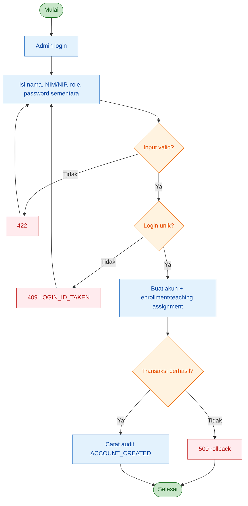
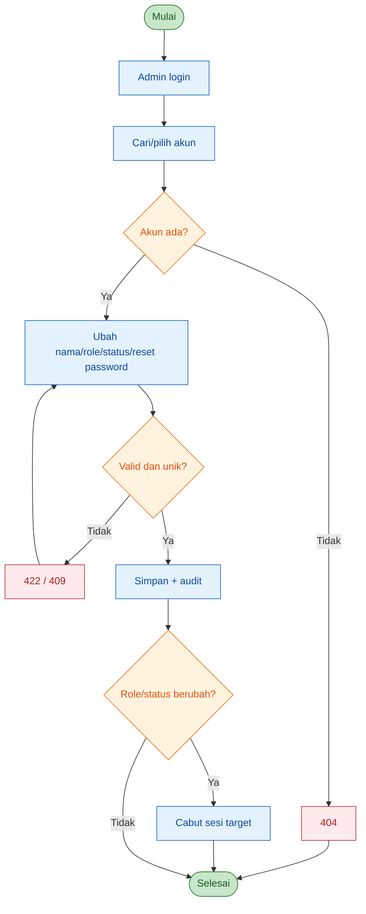
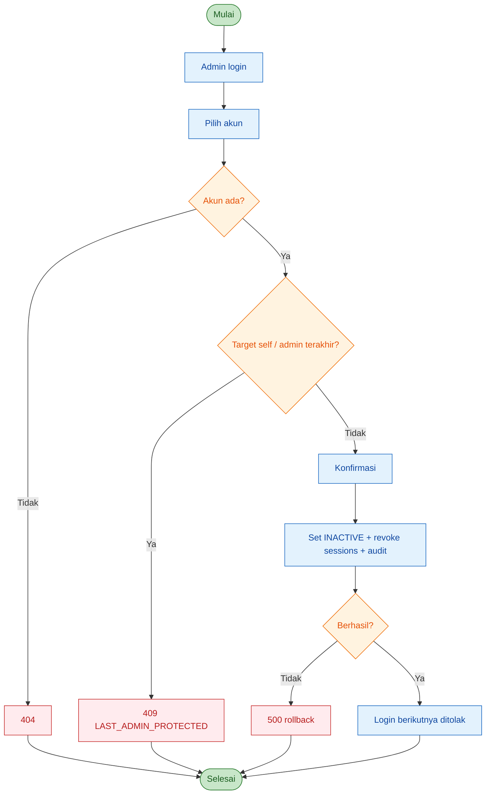

# Activity Diagram — Admin

**Notasi:** Mermaid `flowchart` dengan initial/final state, decision node, dan guard.  
**Cakupan:** AD-A01–AD-A03.

---

## AD-A01 — Membuat Akun

**Guard:** Role hanya tiga kategori; password sementara; auto-enroll/assign.

---

## AD-A02 — Melihat dan Memperbarui Akun

**Guard:** Admin tidak dapat mengubah data akademik; last-admin guard.

---

## AD-A03 — Menonaktifkan Akun

**Guard:** Histori akademik tetap; sesi aktif dicabut.
