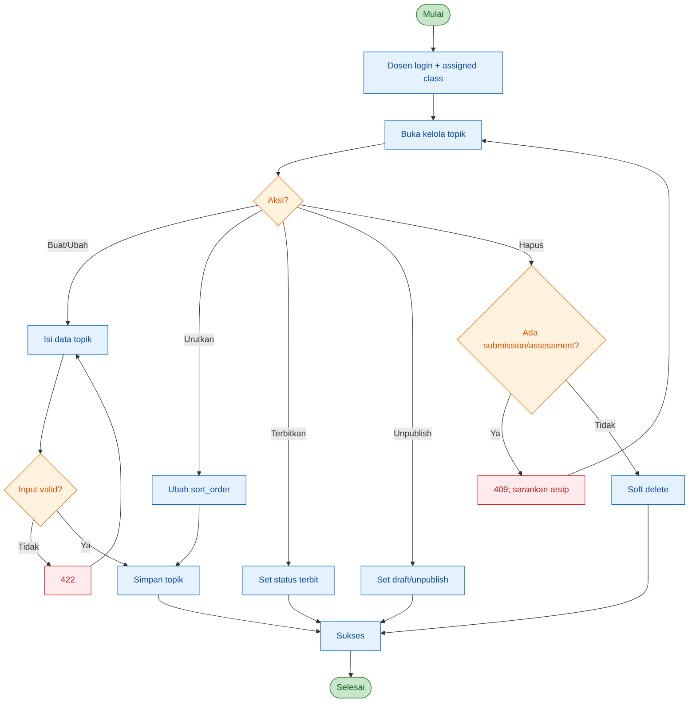
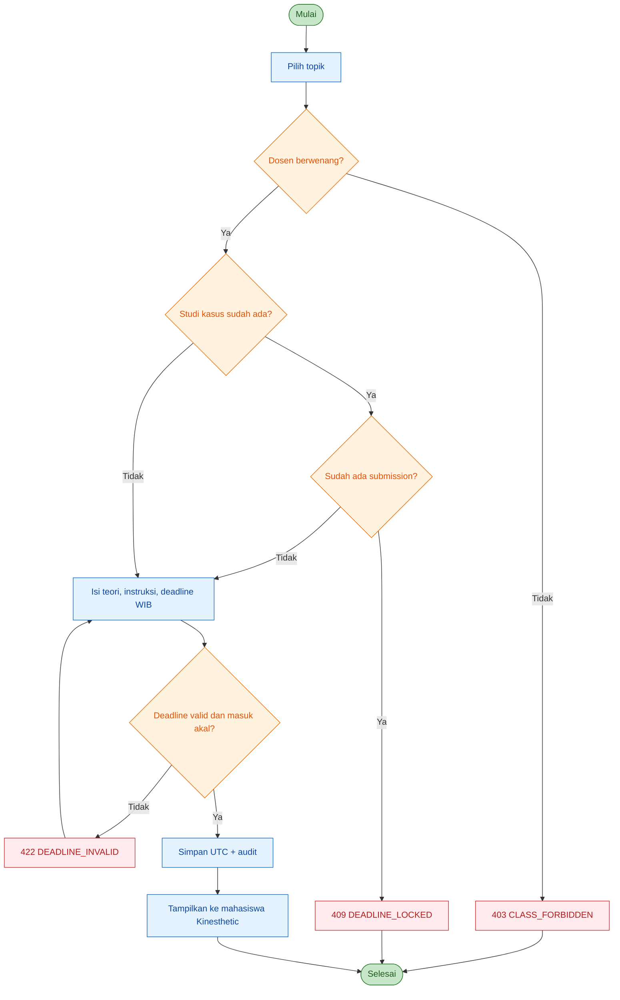
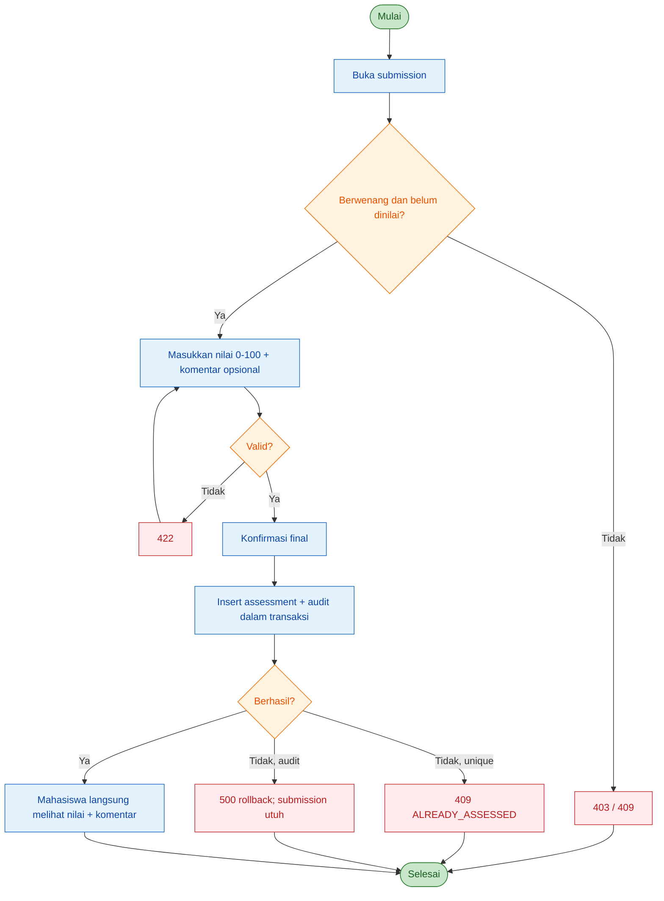
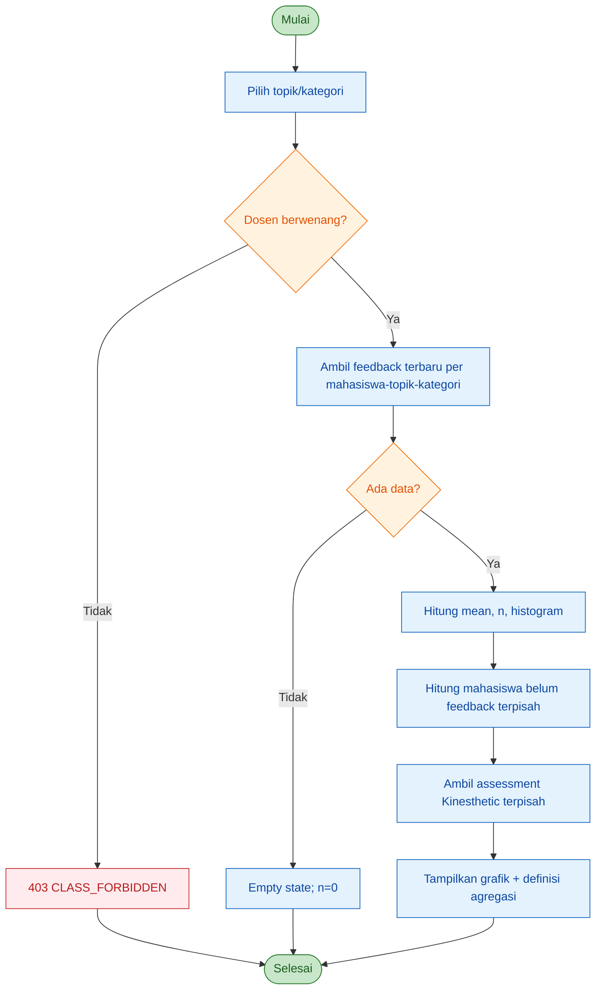
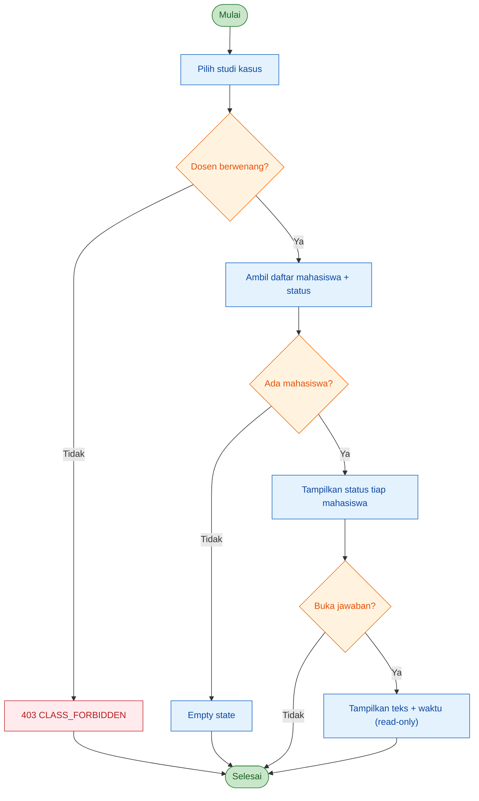

# Activity Diagram — Dosen

**Notasi:** Mermaid `flowchart` dengan initial/final state, decision node, dan guard.  
**Cakupan:** AD-D01–AD-D05.

---

## AD-D01 — Mengelola dan Menerbitkan Materi

**Guard:** Publikasi boleh tanpa materi lengkap; topik dengan data akademik tidak di-hard-delete.

---

## AD-D02 — Membuat Studi Kasus dan Deadline

**Guard:** Satu kasus per topik; deadline terkunci setelah submission pertama.

---

## AD-D03 — Melakukan Penilaian Final

**Guard:** Nilai final; tidak ada update/delete; admin tidak boleh menilai.

---

## AD-D04 — Melihat Grafik Pemahaman

**Guard:** Jangan mencampur rerata subjektif dengan nilai objektif Kinesthetic.

---

## AD-D05 — Memeriksa Pengumpulan Kinesthetic

**Guard:** `Tidak Mengumpulkan` bukan nilai 0; jawaban read-only.
