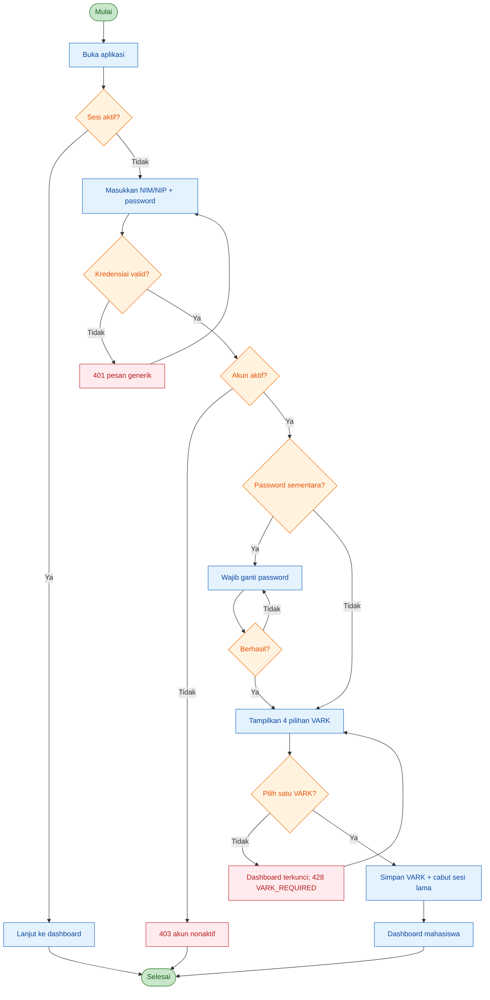
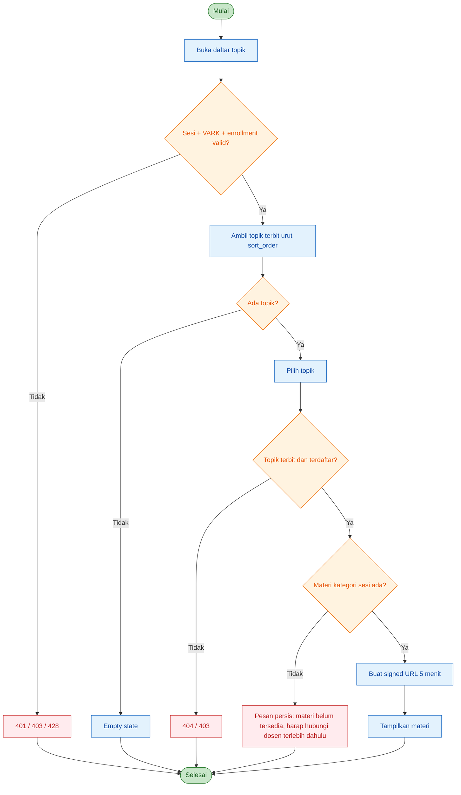
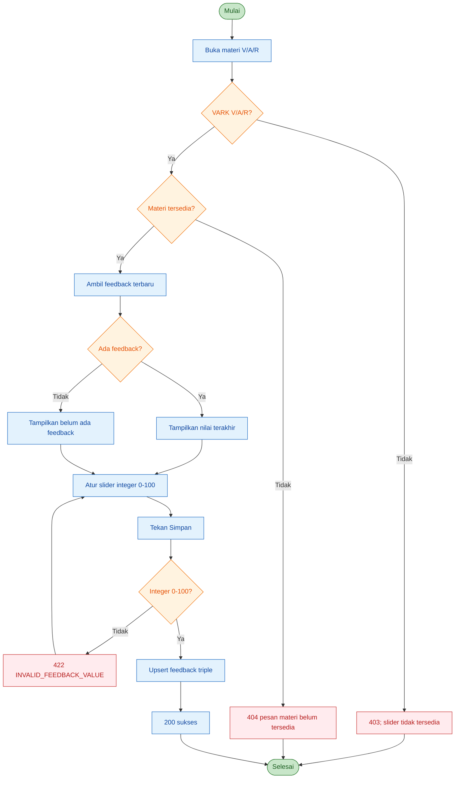
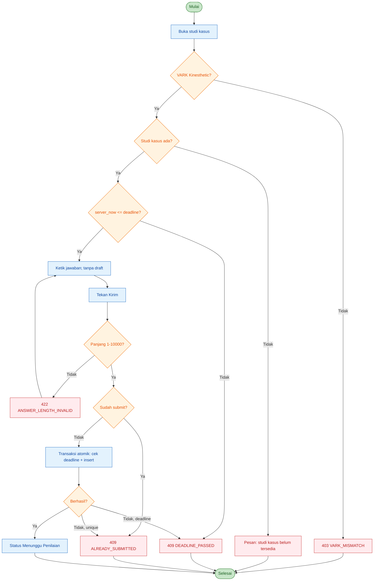
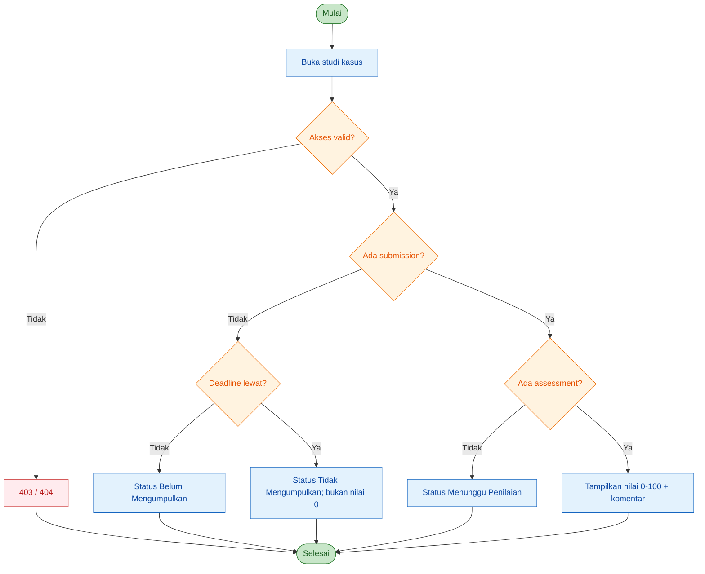

# Activity Diagram — Mahasiswa

**Notasi:** Mermaid `flowchart` dengan initial/final state, decision node, dan guard.  
**Cakupan:** AD-M01–AD-M05.

---

## AD-M01 — Login dan Pemilihan VARK

**Guard:** VARK wajib sebelum endpoint akademik; satu sesi aktif (D-04).

---

## AD-M02 — Mengakses Materi Berdasarkan Preferensi

**Guard:** Hanya kategori sesi; URL kategori lain ditolak backend.

---

## AD-M03 — Memberikan atau Memperbarui Feedback

**Guard:** Feedback per topik–kategori, bukan per materi; kategori lain tidak berubah.

---

## AD-M04 — Mengumpulkan Studi Kasus Kinesthetic

**Guard:** Deadline inklusif; unique submission; tidak ada draft/revisi.

---

## AD-M05 — Melihat Status dan Hasil Penilaian

**Guard:** Status dihitung server; tidak ada opsi revisi.
