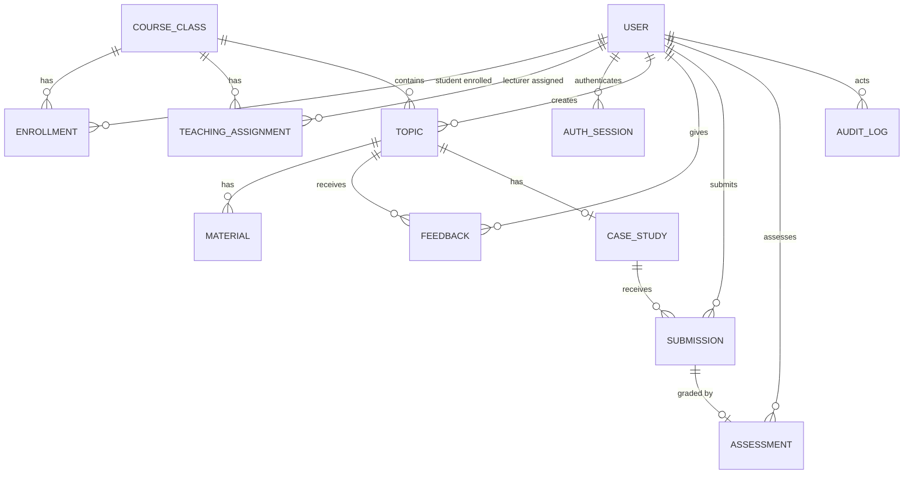

# ERD Konseptual — EduVARK v0.7

**Tujuan:** Memodelkan entitas bisnis, hubungan, dan kardinalitas tanpa terikat tipe data fisik.  
**Status:** Konseptual; bukan DDL dan bukan skema final.  
**Sumber:** SRS v0.7 + D-01–D-18.

## 1. Konseptual vs logis vs fisik

| Level | Isi | Belum diputuskan |
|---|---|---|
| **Konseptual** (dokumen ini) | Entitas, fungsi, hubungan, kardinalitas, aturan bisnis | Nama kolom teknis, tipe data, index |
| **Logis** (`ERD_LOGICAL_DRAFT.md`) | PK/FK, atribut, tipe, nullability, unique/check | DDL final, partitioning, RLS |
| **Fisik** (nanti) | DDL PostgreSQL/Supabase, index, trigger, migration | Diturunkan dari logis setelah persetujuan |

> Konseptual tidak boleh dianggap sebagai keputusan final tipe data. Keputusan seperti UUID vs bigint, enum vs lookup table, dan JSONB vs kolom terpisah berada di level logis/fisik.

## 2. Diagram konseptual

## 3. Katalog entitas

> **Catatan penamaan:** entitas `COURSE_CLASS` adalah “kelas IBD” dalam SRS. Nama ini dipakai di Mermaid karena `CLASS` adalah reserved word Mermaid. Nama tabel fisik yang diusulkan: `classes`.

| Entitas | Fungsi | Atribut utama | Kunci | Relasi & kardinalitas | Constraint bisnis | Ref |
|---|---|---|---|---|---|---|
| **USER** | Identitas login dan role | `login_id`, `full_name`, `password_hash`, `role`, `status`, `must_change_password` | PK `id` | 1 USER → N AUTH_SESSION, ENROLLMENT, TEACHING_ASSIGNMENT, TOPIC (creator), FEEDBACK, SUBMISSION, ASSESSMENT, AUDIT_LOG | `login_id` unik; role ∈ {STUDENT, LECTURER, ADMIN}; status ∈ {ACTIVE, INACTIVE} | FR-001–008, FR-034–037 |
| **COURSE_CLASS** | Kelas IBD (satu kelas MVP) | `code`, `name`, `semester` | PK `id` | 1 COURSE_CLASS → N ENROLLMENT, TEACHING_ASSIGNMENT, TOPIC | Satu kelas aktif untuk MVP; kode unik | BR-01, FR-009, FR-014 |
| **ENROLLMENT** | Keanggotaan mahasiswa di kelas | `status`, `enrolled_at`, `left_at` | PK `id`; FK `class_id`, `student_id` | N ENROLLMENT → 1 USER (student), 1 COURSE_CLASS; USER 1 → N ENROLLMENT (historis) | Unik (`class_id`, `student_id`); status ∈ {ACTIVE, LEFT} | FR-014, BR-15, D-06, D-13 |
| **TEACHING_ASSIGNMENT** | Penugasan dosen ke kelas | `assigned_at` | PK `id`; FK `class_id`, `lecturer_id` | N → 1 USER (lecturer), 1 COURSE_CLASS | Unik (`class_id`, `lecturer_id`) | FR-003, FR-009–013, D-06 |
| **AUTH_SESSION** | Sesi login + VARK aktif | `vark_type`, `token_hash`, `created_at`, `last_seen_at`, `expires_at`, `revoked_at` | PK `id`; FK `user_id` | N → 1 USER; USER 1 → N sesi historis | Tepat satu VARK per sesi; satu sesi aktif per user; VARK immutable setelah di-set | FR-001–008, D-03, D-04 |
| **TOPIC** | Topik pembelajaran | `title`, `description`, `sort_order`, `status`, `deleted_at` | PK `id`; FK `class_id`, `created_by` | N → 1 COURSE_CLASS; N → 1 USER (creator); 1 TOPIC → N MATERIAL, N FEEDBACK, 0..1 CASE_STUDY | Urutan per kelas; status ∈ {DRAFT, PUBLISHED}; soft delete | FR-009–017, FR-023, D-07 |
| **MATERIAL** | Materi per topik–kategori | `vark_type`, `title`, `kind`, `object_key`/`url`, `mime`, `size_bytes`, `deleted_at` | PK `id`; FK `topic_id`, `uploaded_by` | N → 1 TOPIC; N → 1 USER (uploader) | Kategori ∈ empat VARK; satu topik–kategori boleh N materi; soft delete | FR-010–016, D-05, D-07 |
| **FEEDBACK** | Feedback subjektif V/A/R | `vark_type`, `value`, `created_at`, `updated_at` | PK `id`; FK `student_id`, `topic_id` | N → 1 USER (student), 1 TOPIC | Unik (`student_id`, `topic_id`, `vark_type`); value 0–100; vark ∈ V/A/R | FR-018–022, BR-04, BR-09 |
| **CASE_STUDY** | Studi kasus Kinesthetic | `theory`, `instructions`, `deadline_at`, `deleted_at` | PK `id`; FK `topic_id` (unik), `created_by` | 0..1 CASE_STUDY → 1 TOPIC; 1 CASE_STUDY → N SUBMISSION | Satu kasus per topik; deadline wajib; soft delete | FR-023–025, FR-040, D-08 |
| **SUBMISSION** | Jawaban final mahasiswa | `answer_text`, `submitted_at` | PK `id`; FK `case_study_id`, `student_id` | N → 1 CASE_STUDY; N → 1 USER (student); 1 SUBMISSION → 0..1 ASSESSMENT | Unik (`student_id`, `case_study_id`); panjang 1–10.000; immutable | FR-025, FR-038–041, FR-045–050 |
| **ASSESSMENT** | Nilai final dosen | `score`, `comment`, `assessed_at` | PK `id`; FK `submission_id` (unik), `assessed_by` | 0..1 ASSESSMENT → 1 SUBMISSION; N → 1 USER (assessor) | Unik `submission_id`; score 0–100; komentar ≤1.000; immutable | FR-026–028, FR-043–044, D-10 |
| **AUDIT_LOG** | Jejak aksi penting | `action`, `entity`, `entity_id`, `metadata`, `created_at` | PK `id`; FK `actor_id` | N → 1 USER (actor) | Append-only; retensi 1 tahun | D-13 |

## 4. Entitas yang sengaja **tidak** dibuat

| Kandidat | Keputusan | Alasan |
|---|---|---|
| **ROLE** sebagai tabel | Tidak; enum pada `USER.role` | Hanya tiga role tetap (FR-035). Tabel role akan menambah join tanpa manfaat MVP. |
| **VARK_PREFERENCE** sebagai tabel | Tidak; `AUTH_SESSION.vark_type` | Preferensi aktif melekat pada sesi, bukan profil permanen (BR-02). Kategori asal feedback disimpan di `FEEDBACK.vark_type`. |
| **SUBMISSION_STATUS** sebagai tabel/kolom | Tidak; status **diturunkan** | `Tidak Mengumpulkan` tidak boleh membuat submission/nilai 0 (FR-048). Status dihitung dari deadline + submission + assessment. |
| **MATERIAL_CATEGORY** sebagai tabel | Tidak; enum `vark_type` | Empat kategori tetap; enum cukup dan lebih ketat. |
| **REPORT** | Tidak | Analitik dihitung dari feedback/assessment; tidak ada laporan tersimpan. |

## 5. Kardinalitas dan aturan integritas

### 5.1 Satu VARK aktif per sesi
- `AUTH_SESSION.vark_type` nullable sampai mahasiswa memilih.
- Setelah diisi, trigger/guard menolak perubahan.
- Satu user hanya boleh punya satu sesi aktif; sesi historis tetap disimpan.

### 5.2 Feedback terpisah per mahasiswa–topik–kategori
- `FEEDBACK` unik pada (`student_id`, `topic_id`, `vark_type`).
- Simpan ulang = update baris yang sama; tidak ada tabel riwayat.
- `vark_type` adalah kategori **asal feedback**, bukan VARK sesi saat ini.

### 5.3 Satu jawaban final per mahasiswa–studi kasus
- `SUBMISSION` unik pada (`student_id`, `case_study_id`).
- Tidak ada kolom draft; teks hanya muncul setelah Kirim.
- Trigger menolak perubahan `answer_text`.

### 5.4 Satu penilaian final per submission
- `ASSESSMENT` unik pada `submission_id`.
- Insert-only; trigger menolak UPDATE/DELETE.

### 5.5 `Tidak Mengumpulkan` tanpa submission palsu
- Tidak ada baris `SUBMISSION` dan tidak ada `ASSESSMENT`.
- Status dihitung: `now() > deadline_at` dan tidak ada submission.
- Nilai 0 hanya sah jika berasal dari assessment.

### 5.6 Integritas saat request paralel
- Unique constraint + transaksi untuk submission/assessment.
- Deadline memakai `now()` database di transaksi yang sama.
- `SELECT ... FOR UPDATE` pada baris studi kasus (opsional) atau unique constraint untuk serialisasi.
- Optimistic concurrency pada topik/materi (mis. `updated_at`).

## 6. Referensi silang

- Aturan validasi: [`../../srs/SRS_EDUVARK_V0.7_COMPLETION.md`](../../srs/SRS_EDUVARK_V0.7_COMPLETION.md) §6.
- RTM: [`../../srs/REQUIREMENTS_TRACEABILITY_MATRIX.md`](../../srs/REQUIREMENTS_TRACEABILITY_MATRIX.md).
- ERD logis: `ERD_LOGICAL_DRAFT.md`.
