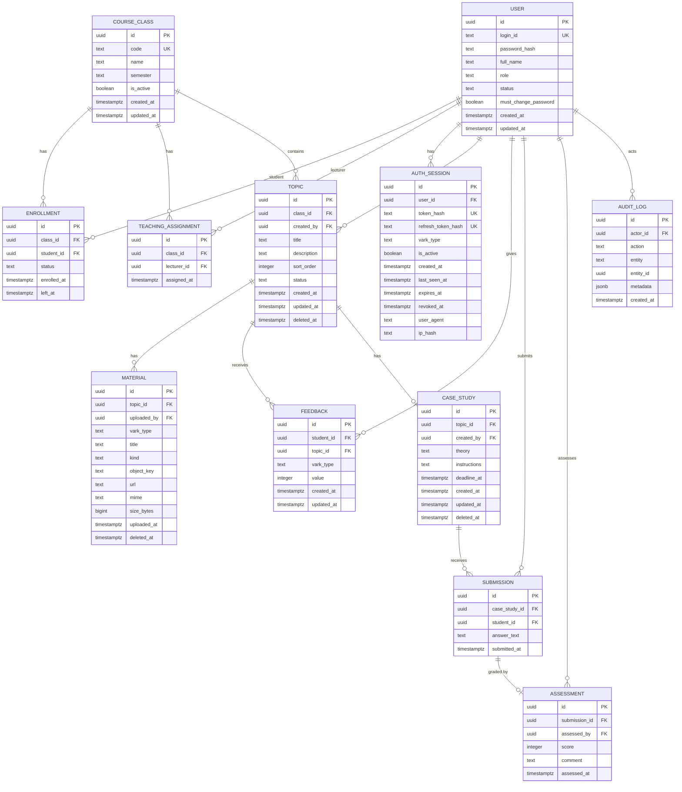

# ERD Logis (Draft) — EduVARK v0.7

**Tujuan:** Menerjemahkan ERD konseptual menjadi struktur relasional dengan PK/FK, tipe, nullability, unique/check, index, dan trigger.  
**Status:** **Draft** — bukan DDL final; belum dieksekusi ke database.  
**DB:** PostgreSQL via Supabase (D-02).  
**Sumber:** SRS v0.7 + D-01–D-18.

> Model ini belum menjadi migration. Perubahan tipe/enum/index masih mungkin setelah review. Jangan menganggap draft ini sebagai skema produksi.

## 1. Perbedaan konseptual dan logis

| Aspek | Konseptual | Logis (draft ini) |
|---|---|---|
| Entitas | 12 entitas bisnis | 12 tabel |
| Atribut | Hanya atribut utama | Semua kolom + tipe + nullability |
| Relasi | Kardinalitas bisnis | FK + on delete/update |
| Aturan | Constraint bisnis | `CHECK`, `UNIQUE`, trigger, index |
| Status | `Tidak Mengumpulkan` konsep | Tidak disimpan; dihitung dari deadline + submission + assessment |

## 2. Diagram logis

## 3. Kamus kolom

### 3.1 USER

| Kolom | Tipe | Null | Default | Constraint |
|---|---|---|---|---|
| `id` | uuid | no | `gen_random_uuid()` | PK |
| `login_id` | text | no | — | UNIQUE; panjang 1–50; trim |
| `password_hash` | text | no | — | Argon2id |
| `full_name` | text | no | — | panjang 1–150 |
| `role` | text | no | — | CHECK in ('STUDENT','LECTURER','ADMIN') |
| `status` | text | no | 'ACTIVE' | CHECK in ('ACTIVE','INACTIVE') |
| `must_change_password` | boolean | no | true | — |
| `created_at` | timestamptz | no | `now()` | — |
| `updated_at` | timestamptz | no | `now()` | trigger |

### 3.2 COURSE_CLASS (tabel fisik: `classes`)

> `COURSE_CLASS` dipakai sebagai nama entitas Mermaid karena `CLASS` reserved word. Nama tabel PostgreSQL yang diusulkan: `classes`.

| Kolom | Tipe | Null | Default | Constraint |
|---|---|---|---|---|
| `id` | uuid | no | `gen_random_uuid()` | PK |
| `code` | text | no | — | UNIQUE |
| `name` | text | no | — | — |
| `semester` | text | no | — | — |
| `is_active` | boolean | no | true | partial unique: satu kelas aktif |
| `created_at` | timestamptz | no | `now()` | — |
| `updated_at` | timestamptz | no | `now()` | trigger |

### 3.3 ENROLLMENT

| Kolom | Tipe | Null | Default | Constraint |
|---|---|---|---|---|
| `id` | uuid | no | `gen_random_uuid()` | PK |
| `class_id` | uuid | no | — | FK → COURSE_CLASS.id |
| `student_id` | uuid | no | — | FK → USER.id |
| `status` | text | no | 'ACTIVE' | CHECK in ('ACTIVE','LEFT') |
| `enrolled_at` | timestamptz | no | `now()` | — |
| `left_at` | timestamptz | yes | null | wajib jika status LEFT |

UNIQUE (`class_id`, `student_id`).

### 3.4 TEACHING_ASSIGNMENT

| Kolom | Tipe | Null | Default | Constraint |
|---|---|---|---|---|
| `id` | uuid | no | `gen_random_uuid()` | PK |
| `class_id` | uuid | no | — | FK → COURSE_CLASS.id |
| `lecturer_id` | uuid | no | — | FK → USER.id |
| `assigned_at` | timestamptz | no | `now()` | — |

UNIQUE (`class_id`, `lecturer_id`).

### 3.5 AUTH_SESSION

| Kolom | Tipe | Null | Default | Constraint |
|---|---|---|---|---|
| `id` | uuid | no | `gen_random_uuid()` | PK |
| `user_id` | uuid | no | — | FK → USER.id |
| `token_hash` | text | no | — | UNIQUE; SHA-256 |
| `refresh_token_hash` | text | no | — | UNIQUE; SHA-256 |
| `vark_type` | text | yes | null | CHECK in empat VARK; immutable setelah diisi |
| `is_active` | boolean | no | true | partial unique per user |
| `created_at` | timestamptz | no | `now()` | — |
| `last_seen_at` | timestamptz | no | `now()` | — |
| `expires_at` | timestamptz | no | — | > created_at |
| `revoked_at` | timestamptz | yes | null | — |
| `user_agent` | text | yes | null | — |
| `ip_hash` | text | yes | null | hash, bukan IP mentah |

Partial unique index: `(user_id) WHERE is_active` — satu sesi aktif.

### 3.6 TOPIC

| Kolom | Tipe | Null | Default | Constraint |
|---|---|---|---|---|
| `id` | uuid | no | `gen_random_uuid()` | PK |
| `class_id` | uuid | no | — | FK → COURSE_CLASS.id |
| `created_by` | uuid | no | — | FK → USER.id |
| `title` | text | no | — | panjang 1–200 |
| `description` | text | yes | null | — |
| `sort_order` | integer | no | 0 | >= 0 |
| `status` | text | no | 'DRAFT' | CHECK in ('DRAFT','PUBLISHED') |
| `created_at` | timestamptz | no | `now()` | — |
| `updated_at` | timestamptz | no | `now()` | trigger |
| `deleted_at` | timestamptz | yes | null | soft delete |

Partial unique: `(class_id, sort_order) WHERE deleted_at IS NULL`. Reorder dalam transaksi deferrable.

### 3.7 MATERIAL

| Kolom | Tipe | Null | Default | Constraint |
|---|---|---|---|---|
| `id` | uuid | no | `gen_random_uuid()` | PK |
| `topic_id` | uuid | no | — | FK → TOPIC.id |
| `uploaded_by` | uuid | no | — | FK → USER.id |
| `vark_type` | text | no | — | CHECK in empat VARK |
| `title` | text | no | — | panjang 1–200 |
| `kind` | text | no | — | CHECK in ('FILE','LINK') |
| `object_key` | text | yes | null | wajib jika FILE |
| `url` | text | yes | null | wajib jika LINK; https |
| `mime` | text | yes | null | allowlist |
| `size_bytes` | bigint | yes | null | 1..104857600 |
| `uploaded_at` | timestamptz | no | `now()` | — |
| `deleted_at` | timestamptz | yes | null | soft delete |

CHECK: `(kind = 'FILE' AND object_key IS NOT NULL) OR (kind = 'LINK' AND url IS NOT NULL)`.

### 3.8 FEEDBACK

| Kolom | Tipe | Null | Default | Constraint |
|---|---|---|---|---|
| `id` | uuid | no | `gen_random_uuid()` | PK |
| `student_id` | uuid | no | — | FK → USER.id |
| `topic_id` | uuid | no | — | FK → TOPIC.id |
| `vark_type` | text | no | — | CHECK in ('VISUAL','AURAL','READ_WRITE') |
| `value` | integer | no | — | CHECK 0..100 |
| `created_at` | timestamptz | no | `now()` | — |
| `updated_at` | timestamptz | no | `now()` | trigger |

UNIQUE (`student_id`, `topic_id`, `vark_type`).

### 3.9 CASE_STUDY

| Kolom | Tipe | Null | Default | Constraint |
|---|---|---|---|---|
| `id` | uuid | no | `gen_random_uuid()` | PK |
| `topic_id` | uuid | no | — | FK → TOPIC.id |
| `created_by` | uuid | no | — | FK → USER.id |
| `theory` | text | yes | null | — |
| `instructions` | text | no | — | panjang 1–10000 |
| `deadline_at` | timestamptz | no | — | — |
| `created_at` | timestamptz | no | `now()` | — |
| `updated_at` | timestamptz | no | `now()` | trigger |
| `deleted_at` | timestamptz | yes | null | soft delete |

Partial unique: `(topic_id) WHERE deleted_at IS NULL` — satu kasus aktif per topik.

### 3.10 SUBMISSION

| Kolom | Tipe | Null | Default | Constraint |
|---|---|---|---|---|
| `id` | uuid | no | `gen_random_uuid()` | PK |
| `case_study_id` | uuid | no | — | FK → CASE_STUDY.id |
| `student_id` | uuid | no | — | FK → USER.id |
| `answer_text` | text | no | — | CHECK char_length 1..10000 |
| `submitted_at` | timestamptz | no | `now()` | — |

UNIQUE (`student_id`, `case_study_id`).

### 3.11 ASSESSMENT

| Kolom | Tipe | Null | Default | Constraint |
|---|---|---|---|---|
| `id` | uuid | no | `gen_random_uuid()` | PK |
| `submission_id` | uuid | no | — | FK → SUBMISSION.id; UNIQUE |
| `assessed_by` | uuid | no | — | FK → USER.id |
| `score` | integer | no | — | CHECK 0..100 |
| `comment` | text | yes | null | CHECK char_length <= 1000 |
| `assessed_at` | timestamptz | no | `now()` | — |

### 3.12 AUDIT_LOG

| Kolom | Tipe | Null | Default | Constraint |
|---|---|---|---|---|
| `id` | uuid | no | `gen_random_uuid()` | PK |
| `actor_id` | uuid | yes | null | FK → USER.id; null untuk sistem |
| `action` | text | no | — | mis. `LOGIN`, `VARK_SELECTED`, `ASSESSMENT_SAVED` |
| `entity` | text | no | — | nama entitas |
| `entity_id` | uuid | yes | null | — |
| `metadata` | jsonb | yes | '{}' | tanpa password/token |
| `created_at` | timestamptz | no | `now()` | — |

## 4. Index dan constraint penting

| Nama | Tabel | Definisi | Tujuan |
|---|---|---|---|
| `ux_users_login` | USER | UNIQUE(`login_id`) | FR-036 |
| `ux_auth_active_user` | AUTH_SESSION | UNIQUE(`user_id`) WHERE `is_active` | D-04 satu sesi aktif |
| `ux_auth_token` | AUTH_SESSION | UNIQUE(`token_hash`) | validasi token |
| `ux_auth_refresh` | AUTH_SESSION | UNIQUE(`refresh_token_hash`) | rotasi refresh |
| `ux_enrollment` | ENROLLMENT | UNIQUE(`class_id`, `student_id`) | cegah duplikasi |
| `ux_teaching` | TEACHING_ASSIGNMENT | UNIQUE(`class_id`, `lecturer_id`) | cegah duplikasi |
| `ux_topic_order` | TOPIC | UNIQUE(`class_id`, `sort_order`) WHERE `deleted_at IS NULL` | FR-017 |
| `ix_material_topic_vark` | MATERIAL | (`topic_id`, `vark_type`) WHERE `deleted_at IS NULL` | FR-014 |
| `ux_feedback_triple` | FEEDBACK | UNIQUE(`student_id`, `topic_id`, `vark_type`) | FR-019 |
| `ix_feedback_topic` | FEEDBACK | (`topic_id`, `vark_type`) | FR-029 |
| `ux_case_topic` | CASE_STUDY | UNIQUE(`topic_id`) WHERE `deleted_at IS NULL` | D-08 |
| `ux_submission_pair` | SUBMISSION | UNIQUE(`student_id`, `case_study_id`) | FR-025 |
| `ix_submission_case` | SUBMISSION | (`case_study_id`) | UC-D04 |
| `ux_assessment_submission` | ASSESSMENT | UNIQUE(`submission_id`) | FR-044 |
| `ix_audit_actor_time` | AUDIT_LOG | (`actor_id`, `created_at`) | OQ-04 |

## 5. Trigger dan aturan immutability

| Trigger | Tabel | Event | Aksi |
|---|---|---|---|
| `trg_users_updated` | USER | BEFORE UPDATE | set `updated_at = now()` |
| `trg_topics_updated` | TOPIC | BEFORE UPDATE | set `updated_at` |
| `trg_materials_updated` | MATERIAL | BEFORE UPDATE | set `updated_at` |
| `trg_feedback_updated` | FEEDBACK | BEFORE UPDATE | set `updated_at` |
| `trg_cases_updated` | CASE_STUDY | BEFORE UPDATE | set `updated_at` |
| `trg_session_vark_lock` | AUTH_SESSION | BEFORE UPDATE | tolak perubahan `vark_type` jika sudah non-null |
| `trg_submission_immutable` | SUBMISSION | BEFORE UPDATE/DELETE | tolak perubahan `answer_text` dan delete |
| `trg_assessment_immutable` | ASSESSMENT | BEFORE UPDATE/DELETE | tolak update/delete |
| `trg_audit_append_only` | AUDIT_LOG | BEFORE UPDATE/DELETE | tolak update/delete |
| `trg_deadline_lock` | CASE_STUDY | BEFORE UPDATE | tolak perubahan `deadline_at` jika sudah ada submission |

> Catatan: trigger `deadline_lock` membutuhkan query ke `SUBMISSION`; untuk konkurensi tinggi, service juga harus memeriksa dalam transaksi. Trigger adalah pertahanan terakhir, bukan pengganti validasi service.

## 6. View status (opsional)

Status `Tidak Mengumpulkan` tidak disimpan. Jika diperlukan untuk query dosen, buat view:

| View | Isi | Catatan |
|---|---|---|
| `v_student_case_status` | `student_id`, `case_study_id`, `status`, `score`, `comment` | CASE: submission/assessment + `now()` vs `deadline_at`; tidak membuat baris submission |

View ini memudahkan UC-D04/UC-M06, tetapi keputusan status tetap dianggap logika server. Jika view dipakai, pastikan `now()` dievaluasi konsisten.

## 7. Keputusan teknis yang masih terbuka

| Isu | Rekomendasi | Status |
|---|---|---|
| UUID vs bigint | UUID (`gen_random_uuid()`) | Rekomendasi; belum final |
| Enum vs text+CHECK | text + CHECK untuk MVP; enum jika stabil | Rekomendasi |
| `is_active` pada session | Ya, untuk partial unique index | Rekomendasi |
| `ip_hash` vs IP mentah | Hash (privasi) | Rekomendasi |
| `comment` kosong | `null`, bukan string kosong | Rekomendasi |
| Soft delete topik | `deleted_at` + partial unique | Sesuai D-07 |
| RLS Supabase | Tidak diandalkan sebagai satu-satunya kontrol | Rekomendasi |
| Case study 1:1 | Partial unique `topic_id` | Sesuai D-08 |
| Retensi/purge | 1 tahun; mekanisme OQ-03 | TBD |

## 8. Integritas untuk permintaan paralel

1. **Submission ganda:** transaksi + `UNIQUE(student_id, case_study_id)`; pelanggaran unique → `409`.
2. **Deadline:** `now()` database di transaksi; `SELECT ... FOR UPDATE` pada `CASE_STUDY` sebelum insert.
3. **Assessment ganda:** `UNIQUE(submission_id)`; satu request menang.
4. **Sesi ganda:** partial unique `(user_id) WHERE is_active`; login baru menonaktifkan sesi lama dalam transaksi.
5. **Feedback ganda:** unique triple + upsert; tidak ada dua baris.
6. **Reorder topik:** transaksi deferrable unique atau update dua fase untuk menghindari konflik `sort_order`.

## 9. Catatan Supabase

- Supabase menyediakan PostgreSQL; draft ini tidak memakai Auth/Storage Supabase (lihat OQ-01).
- Jika RLS diaktifkan, backend tetap memakai service role untuk operasi terotorisasi; RLS menjadi defense-in-depth, bukan pengganti validasi service.
- `pgcrypto`/ `gen_random_uuid()` tersedia di PostgreSQL modern.
- Backup/PITR dan retensi mengikuti OQ-03.
