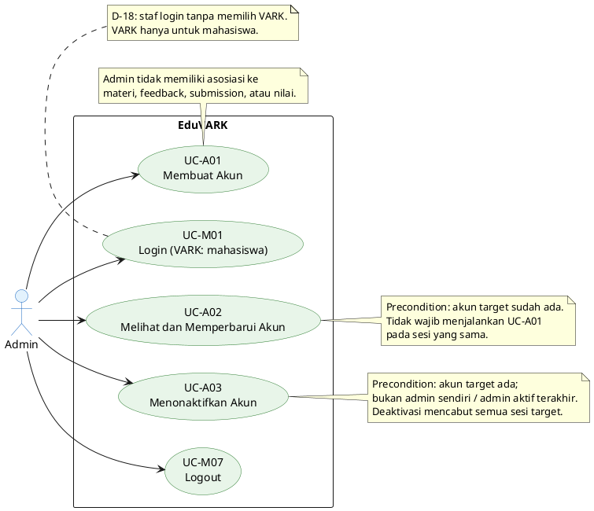

# Use Case Diagram — Admin

**Notasi:** PlantUML (UML use case). Mermaid tidak dipakai karena tidak mendukung notasi use case UML secara tepat.  
**Source:** blok di bawah dapat diedit dan dirender ulang.

## Catatan

- Tidak ada `<<include>>`/`<<extend>>`; prasyarat akun target adalah guard, bukan include.
- Admin hanya mengelola akun (BR-06, FR-034–FR-037).
- Login admin adalah *shared precondition* (lihat OQ-15).
