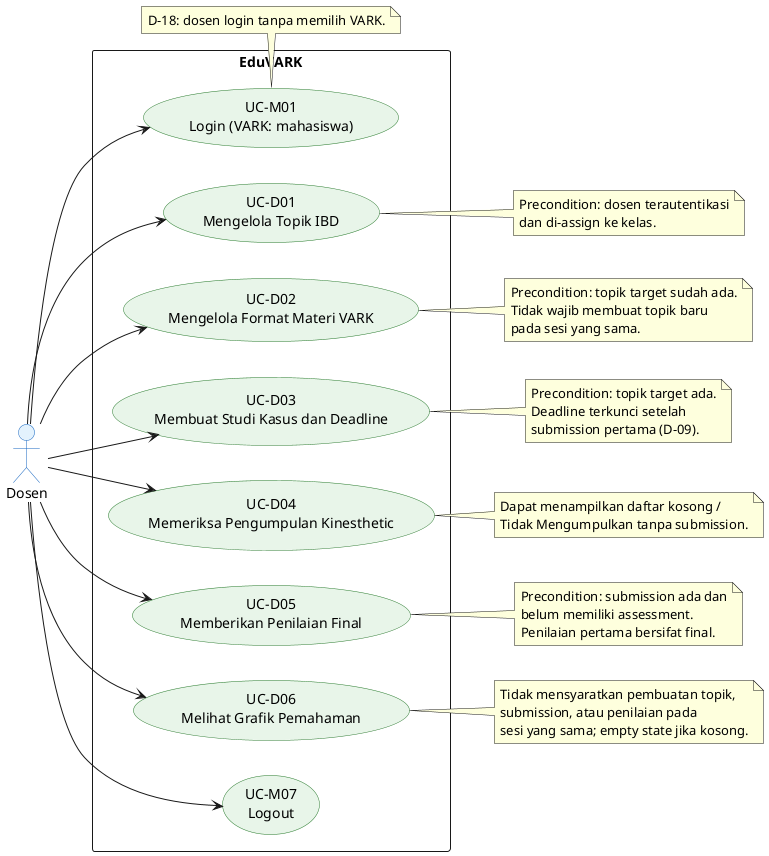

# Use Case Diagram — Dosen

**Notasi:** PlantUML (UML use case).  
**Source:** blok di bawah dapat diedit dan dirender ulang.

## Catatan

- Tidak ada relasi `<<include>>`/`<<extend>>`; semua prasyarat adalah guard data/otorisasi.
- `UC-D02` dan `UC-D03` hanya membutuhkan topik yang sudah ada.
- Login dosen adalah *shared precondition* (lihat OQ-15).
