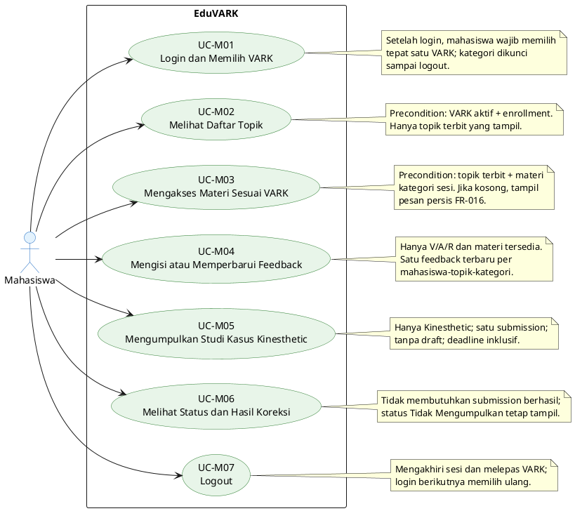

# Use Case Diagram — Mahasiswa

**Notasi:** PlantUML (UML use case).  
**Source:** blok di bawah dapat diedit dan dirender ulang.

## Catatan

- Tidak ada relasi `<<include>>`/`<<extend>>`; prasyarat adalah guard.
- `UC-M04` dan `UC-M05` adalah jalur berbeda berdasarkan kategori sesi.
- Login mahasiswa mencakup pemilihan VARK; login staf tidak termasuk di sini (OQ-15).
