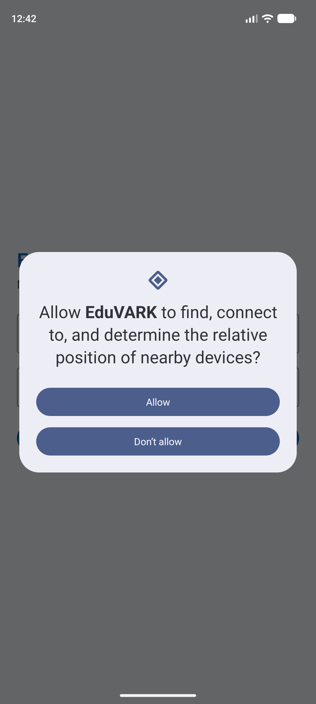
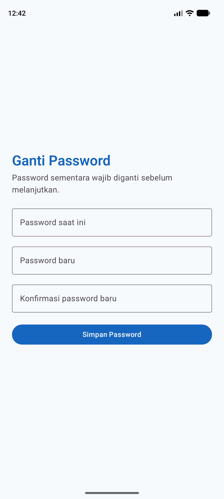

# Login Network Fix — EduVARK Debug/Emulator

**Tanggal:** 21 November 2026  
**Status:** Akar masalah ditemukan dan login berhasil diuji di emulator (HTTP 200 + audit backend).

## 1. Gejala

- Login menampilkan “tidak dapat terhubung ke server”.
- Backend tidak menerima `POST /api/v1/auth/login`.
- Logcat kosong; exception hanya dipetakan ke pesan umum.
- Build debug sebelumnya memakai IP LAN `192.168.0.109`; release tetap placeholder.

## 2. Investigasi dan akar masalah

1. **Varian terpasang diperiksa.** Package yang terpasang hanya `com.eduvark.app.debug`; generated BuildConfig dan dex APK terpasang memang memakai URL yang dikonfigurasi saat itu.
2. **Retrofit diuji dengan kredensial salah.** Request `POST /api/v1/auth/login` terlihat di logcat dan backend membalas `401`. Artinya jalur Retrofit/OkHttp tidak rusak.
3. **Uji dari UID aplikasi, bukan shell.**
   - Shell emulator dapat `GET /health` ke `10.0.2.2:3000` → 200.
   - `run-as com.eduvark.app.debug nc 10.0.2.2 3000` → **Timeout**.
   - `run-as com.eduvark.app.debug nc 192.168.0.109 3000` → 200.
   - Perbedaan ini menunjukkan pembatasan jaringan pada UID aplikasi, bukan DNS/URL Retrofit.
4. **Permission lokal diperiksa.** Aplikasi hanya meminta `INTERNET`. Emulator API 37 memiliki permission dangerous `android.permission.ACCESS_LOCAL_NETWORK`; shell memiliki permission itu, aplikasi tidak.
5. **Perbaikan diuji.** Permission ditambahkan ke debug manifest + runtime request; setelah diizinkan, `run-as ... nc 10.0.2.2` → 200 dan login aplikasi → 200.

**Akar masalah:** akses ke alamat loopback emulator `10.0.2.2` diblokir untuk proses aplikasi karena `ACCESS_LOCAL_NETWORK` belum diminta/diberikan. IP LAN sempat menjadi jalur alternatif, tetapi rapuh dan tidak boleh dijadikan konfigurasi utama.

## 3. Perubahan

| File | Perubahan |
|---|---|
| `app/build.gradle.kts` | Debug URL menjadi `http://10.0.2.2:3000/api/v1/`; tidak lagi memakai IP LAN. Release tidak diubah. |
| `app/src/debug/AndroidManifest.xml` | Menambahkan `ACCESS_LOCAL_NETWORK` hanya untuk debug. |
| `MainActivity.kt` | Meminta permission local network saat debug di API 36+. |
| `NetworkModule.kt` | Logger OkHttp ke logcat; level BASIC; log base URL saat debug. |
| `SafeApiCall.kt` | Log aman `IOException`, tipe exception, dan endpoint; tanpa body/header/kredensial. |
| `AuthRepositoryImpl.kt` | Label endpoint `POST /auth/login` untuk diagnostik. |

## 4. Cara menjalankan ulang

1. Pastikan backend berjalan di port 3000 dan PostgreSQL aktif.
2. Android Studio: pilih Build Variant **appDebug**, lalu Run.
3. Saat pertama kali, izinkan prompt **local network/nearby devices** (hanya debug).
4. Jangan mengganti URL debug ke IP LAN. Emulator memakai `10.0.2.2`.

Alternatif CLI:

```bash
export JAVA_HOME="/Applications/Android Studio.app/Contents/jbr/Contents/Home"
export PATH="$JAVA_HOME/bin:$PATH"
./gradlew :app:assembleDebug
adb install -r app/build/outputs/apk/debug/app-debug.apk
adb shell am start -n com.eduvark.app.debug/com.eduvark.app.MainActivity
```

## 5. Bukti verifikasi

Instalasi bersih + prompt permission:



Setelah permission diberikan, login berhasil:

```text
I/EduVARK: API_BASE_URL=http://10.0.2.2:3000/api/v1/
D/EduVARK-HTTP: --> POST http://10.0.2.2:3000/api/v1/auth/login (47-byte body)
D/EduVARK-HTTP: <-- 200 OK http://10.0.2.2:3000/api/v1/auth/login (507ms, 634-byte body)
```

- Audit backend `LOGIN_SUCCEEDED` bertambah dari 3 → 4.
- Aplikasi masuk ke layar **Ganti Password** (akun seed wajib ganti password).



Catatan keamanan: HTTP BASIC hanya mencatat method/URL/status/ukuran body; tidak mencatat header, password, atau token. Diagnostik exception hanya mencatat tipe exception, endpoint, dan pesan koneksi.

## 6. Hasil test

- Android unit test: **22 lulus**.
- Android lint: **lulus**.
- `assembleDebug` + reinstall: **lulus**.
- Login emulator API 37: **HTTP 200**, audit backend bertambah.

## 7. Catatan

- Permission `ACCESS_LOCAL_NETWORK` hanya ditambahkan di debug; release tidak meminta izin lokal.
- Sesi admin dari pengujian sudah dicabut dan data aplikasi dibersihkan setelah verifikasi.
- Jika pengguna menolak prompt permission, login ke `10.0.2.2` akan kembali gagal; izinkan lewat Settings > Apps > EduVARK > Permissions.
