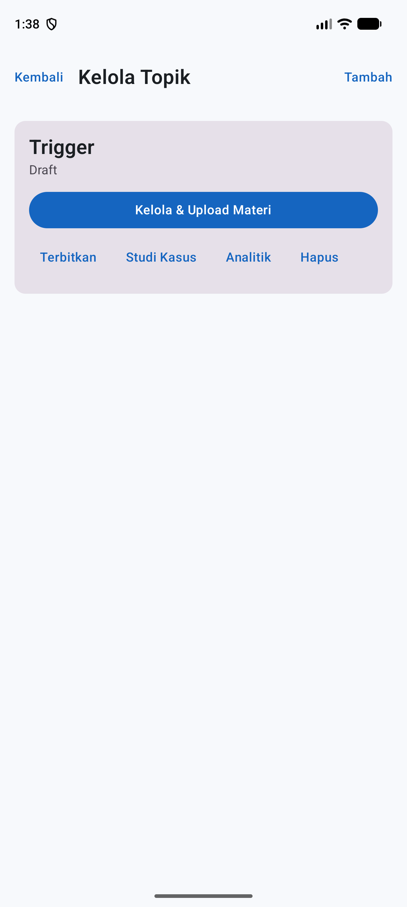
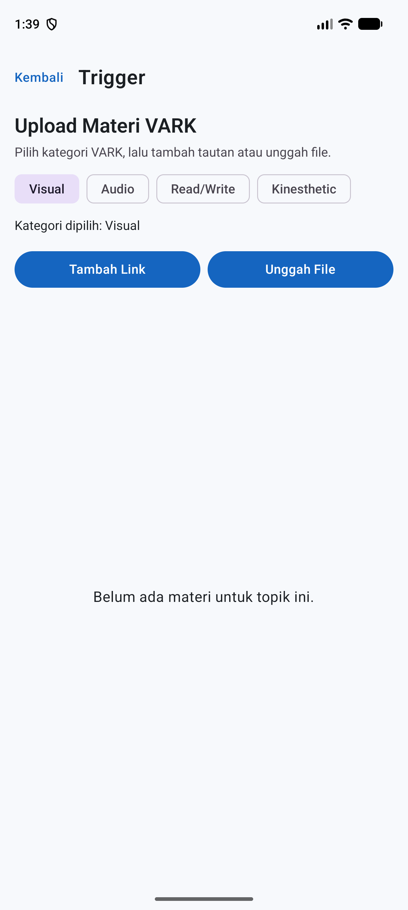
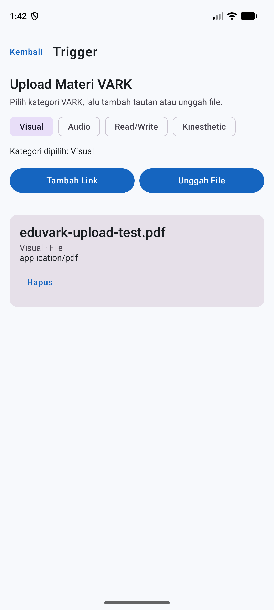

# Material Upload Fix — Dosen VARK

**Tanggal:** 22 November 2026  
**Status:** Tombol upload diperjelas dan upload file berhasil diuji di emulator (HTTP 201).

## 1. Temuan

Tombol upload sebenarnya sudah ada di layar `LecturerMaterialsScreen`, tetapi:

- jalan masuknya hanya tombol teks kecil **Materi** di dalam baris aksi yang horizontal dan terpotong;
- tidak ada judul/label yang menjelaskan bahwa layar itu adalah tempat upload;
- tombol `Unggah File` kurang menonjol.

Akibatnya fitur sulit ditemukan dan tampak “belum ada”.

## 2. Perbaikan UI

- Kartu topik dosen sekarang memiliki tombol penuh **Kelola & Upload Materi**.
- Layar materi memiliki heading **Upload Materi VARK** dan instruksi singkat.
- Label kategori terpilih ditampilkan.
- Tombol **Tambah Link** dan **Unggah File** dibuat lebar dan sejajar.





## 3. Storage development

R2 pada `.env` masih kosong, sehingga upload file akan gagal `502 STORAGE_UNAVAILABLE`. Untuk menguji lokal tanpa R2:

- `storage.ts` memakai fallback filesystem **hanya jika** `NODE_ENV != production` dan semua `R2_*` kosong;
- file disimpan di `backend/storage/materials/`;
- signed URL dibuat dengan HMAC dan TTL 5 menit;
- endpoint `GET /api/v1/material-files?key=...&expires=...&signature=...` menyajikan file;
- path traversal divalidasi;
- produksi tetap **wajib R2** (tanpa fallback).

Konfigurasi opsional ada di `.env.example`:

- `PUBLIC_API_BASE_URL=http://10.0.2.2:3000/api/v1`
- `LOCAL_STORAGE_DIR=storage`

## 4. Verifikasi emulator

1. Login dosen sementara.
2. Buka **Kelola Topik** → **Kelola & Upload Materi**.
3. Pilih VARK Visual.
4. Tekan **Unggah File**, pilih PDF dari Downloads.

Log:

```text
--> POST http://10.0.2.2:3000/api/v1/lecturer/topics/<id>/materials/file (652-byte body)
<-- 201 Created ... (505ms, 505-byte body)
--> GET http://10.0.2.2:3000/api/v1/topics/<id>/materials
<-- 200 OK ... (13ms, 507-byte body)
```

Hasil: materi muncul di daftar dengan judul file, kategori **Visual**, tipe **File**, MIME `application/pdf`.



## 5. Test

- Backend: **75 test lulus** (termasuk unit test local storage).
- Android unit: **26 lulus**.
- Android instrumented: **2/2 lulus**.
- `assembleDebug`, `lintDebug`: lulus.

## 6. Catatan

- Fallback local storage adalah alat development; bukan pengganti R2 produksi.
- File upload nyata ke R2 tetap perlu diuji setelah kredensial R2 tersedia.
- Materi dan akun dosen uji sudah dibersihkan setelah verifikasi.
