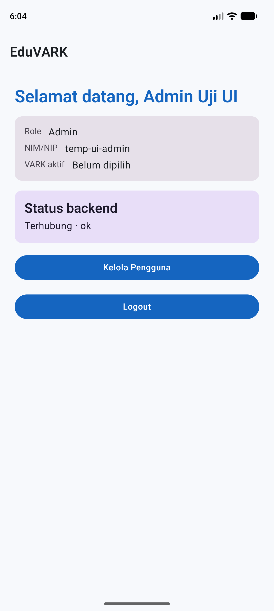
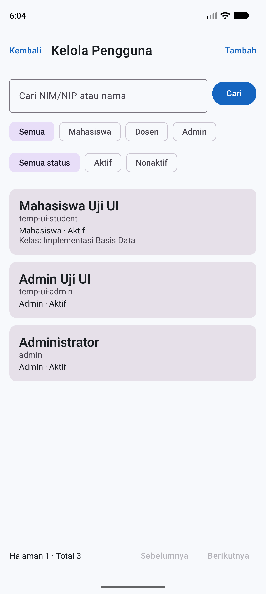
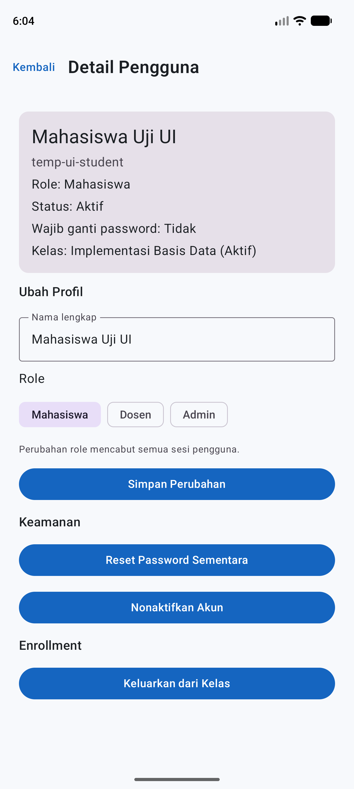
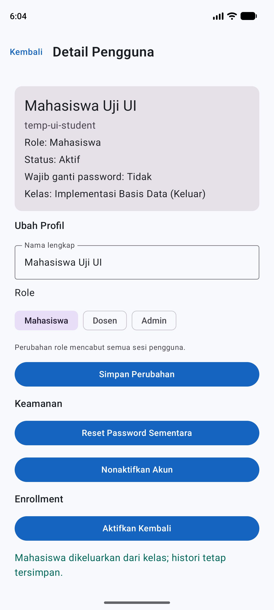

# Phase 9 Report — Admin Android UI

**Tanggal:** 21 November 2026  
**Status:** Selesai; layar admin berfungsi dan diverifikasi di emulator.  
**Lingkup:** FR-034–FR-037/D-17 pada sisi Android, memakai API admin yang sudah ada.

## 1. Latar belakang

Setelah login admin, aplikasi hanya menampilkan halaman selamat datang karena `HomeScreen` memiliki cabang `UserRole.ADMIN -> Unit` dan belum ada route/layar admin. Backend admin sudah lengkap, tetapi UI Android belum dibuat.

## 2. Implementasi

### 2.1 Backend

- `AdminUserResponse` sekarang menyertakan:
  - `enrollmentStatus`, `classCode`, `className`;
  - `teachingClassCode`, `teachingClassName`.
- Query memakai lateral join agar enrollment berstatus `LEFT` tetap memiliki `enrollmentId` dan dapat diaktifkan kembali.
- Enrollment hanya ditampilkan untuk role `STUDENT`; teaching assignment hanya untuk `LECTURER`.

### 2.2 Android

- Menu admin di Home: **Kelola Pengguna**.
- Daftar pengguna:
  - pencarian NIM/NIP/nama;
  - filter role/status;
  - pagination;
  - tampilan kelas dan status enrollment.
- Tambah pengguna:
  - NIM/NIP, nama, role, password sementara + konfirmasi;
- validasi minimal 12 karakter;
- info enrollment/teaching assignment otomatis.
- Detail pengguna:
- ubah nama/role;
- reset password sementara;
- nonaktifkan akun;
- keluarkan/aktifkan kembali enrollment.
- Route admin ditambahkan ke Navigation Compose.

## 3. Bukti eksekusi

| Verifikasi | Hasil |
|---|---|
| Backend typecheck/lint/test | **74 test lulus** |
| Android unit test | **26 test lulus** |
| Android assembleDebug | **Lulus** |
| Android lintDebug | **Lulus** |
| Emulator: GET /admin/users | **200 OK** |
| Emulator: GET /admin/users/:id | **200 OK** |
| Emulator: PATCH /admin/enrollments/:id | **200 OK** |

Log emulator:

```text
--> GET http://10.0.2.2:3000/api/v1/admin/users?page=1&pageSize=20
<-- 200 OK ... (506ms, 1175-byte body)
--> GET http://10.0.2.2:3000/api/v1/admin/users/<id>
<-- 200 OK ... (504ms, 432-byte body)
--> PATCH http://10.0.2.2:3000/api/v1/admin/enrollments/<id>
<-- 200 OK ... (503ms, 106-byte body)
```

### Screenshot









## 4. Catatan pengujian

- Akun uji sementara (`temp-ui-admin`, `temp-ui-student`) dibuat untuk verifikasi emulator, lalu **dihapus** setelah verifikasi; referensi actor pada audit uji dinetralkan.
- Create/reset/deactivate sudah diuji di backend dan unit test Android; verifikasi emulator fokus pada daftar, detail, dan leave enrollment.
- Data aplikasi emulator dibersihkan setelah pengujian.

## 5. Langkah berikutnya

- Uji emulator untuk create user, reset password, deactivate, dan reactivate enrollment.
- Uji role change dari UI (sesi target harus tercabut).
- Lanjut production readiness: R2 nyata, E2E penuh, signing release, load test.
