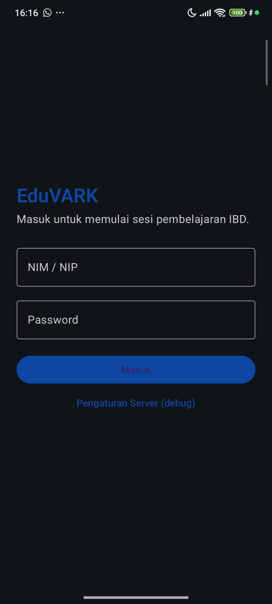

# Physical Device Server Configuration

**Tanggal:** 22 November 2026  
**Status:** Solusi tersedia dan konektivitas backend dari proses aplikasi di HP fisik sudah diverifikasi.

## 1. Masalah

Debug BuildConfig default memakai `10.0.2.2`, alamat khusus emulator Android. Di HP fisik Xiaomi 2312FPCA6G, alamat itu tidak mengarah ke Mac sehingga fitur backend gagal.

`adb reverse` juga tidak berfungsi pada perangkat ini, jadi tidak dijadikan solusi utama.

## 2. Solusi

### 2.1 Pengaturan server di aplikasi (debug)

- Di layar login terdapat tombol **Pengaturan Server (debug)**.
- URL disimpan di DataStore dan dipakai oleh `BaseUrlInterceptor`.
- Interceptor mengganti scheme/host/port pada request API **dan refresh token**, sehingga Retrofit tetap memakai base URL default.
- Layar pengaturan penuh (bukan dialog) agar stabil di MIUI.
- Tombol reset mengembalikan ke default `10.0.2.2`.

Contoh isian untuk Mac saat ini:

```text
http://192.168.0.109:3000/api/v1/
```

Cari IP Mac dengan:

```bash
ipconfig getifaddr en0
```

Jika IP berubah, buka pengaturan lagi dan ganti URL; tidak perlu rebuild.

### 2.2 Override debug lewat ADB (untuk otomasi)

Untuk pengujian otomatis tanpa mengetuk layar:

```bash
adb shell am start -n com.eduvark.app.debug/com.eduvark.app.MainActivity \
  --es api_base_url "http://192.168.0.109:3000/api/v1/"
```

Override ini hanya aktif di build debug.

## 3. Bukti dari HP fisik

Perangkat: Xiaomi 2312FPCA6G, Android API 35, IP `192.168.0.131`.  
Mac/backend: `192.168.0.109:3000`.

Logcat dari proses aplikasi:

```text
I/EduVARK: API_BASE_URL=http://10.0.2.2:3000/api/v1/
D/EduVARK-HTTP: --> GET http://192.168.0.109:3000/api/v1/health
D/EduVARK-HTTP: <-- 200 OK http://192.168.0.109:3000/api/v1/health (434ms, 91-byte body)
I/EduVARK: Server probe OK: ok
```

Artinya proses aplikasi di HP fisik berhasil menghubungi backend melalui IP LAN, bukan hanya shell ADB.



## 4. Catatan

- ADB input injection diblokir MIUI (`INJECT_EVENTS`), sehingga klik-per-klik login tidak diotomasi dari Mac; pengguna dapat mengisi URL lewat layar pengaturan dan login manual.
- Health probe hanya berjalan di debug dan tidak mencatat kredensial/token.
- Release tetap memakai URL produksi dan tidak menampilkan pengaturan server.
- Untuk emulator, default `10.0.2.2` tetap dipakai.

## 5. File

- `app/src/main/java/com/eduvark/app/core/datastore/SettingsStore.kt`
- `app/src/main/java/com/eduvark/app/core/network/BaseUrlInterceptor.kt`
- `app/src/main/java/com/eduvark/app/presentation/auth/ServerSettingsScreen.kt`
- `app/src/main/java/com/eduvark/app/presentation/auth/ServerSettingsViewModel.kt`
- `app/src/main/java/com/eduvark/app/presentation/auth/LoginScreen.kt`
- `app/src/main/java/com/eduvark/app/MainActivity.kt`
