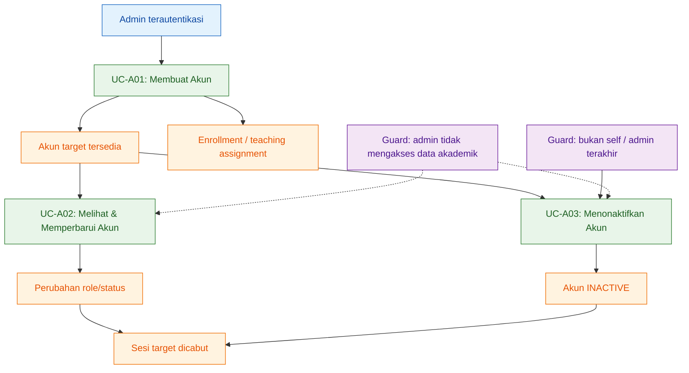
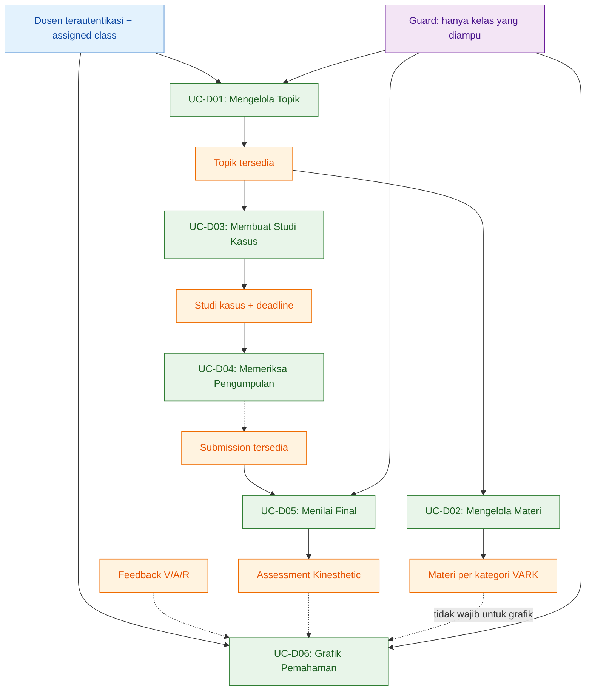
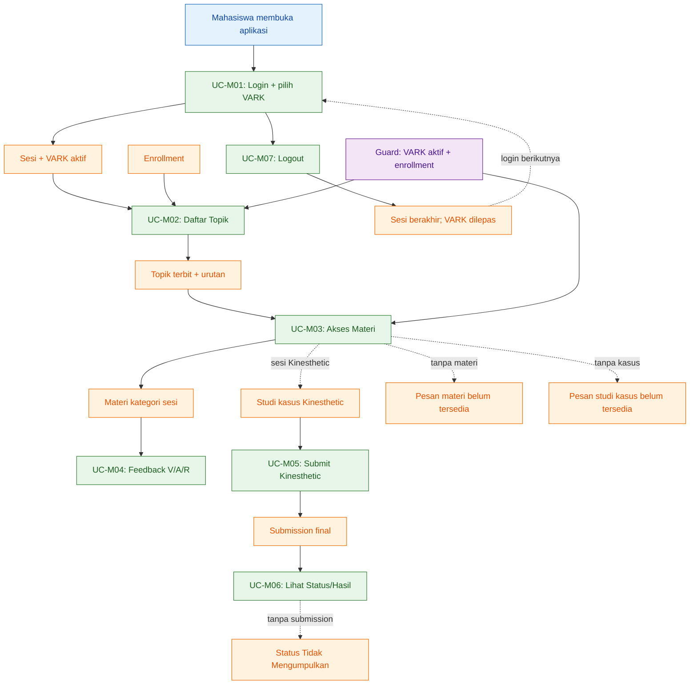
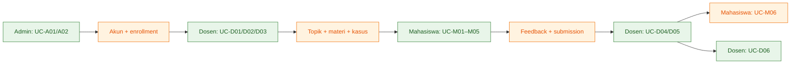

# Use Case Dependencies — EduVARK v0.7

**Tujuan:** Memperlihatkan dependensi **data dan otorisasi** antar use case, bukan urutan wajib eksekusi.  
**Prinsip:** Opsi A — prasyarat dinilai dari keadaan data saat use case dijalankan. `<<include>>` dan `<<extend>>` tidak dipakai untuk menyatakan “objek harus sudah ada”.

## Legenda

| Bentuk | Arti |
|---|---|
| Persegi membulat | Use case |
| Persegi | Data/objek/guard |
| Garis penuh | Dependensi utama |
| Garis putus-putus | Dependensi opsional/kontekstual |

> Diagram ini **bukan** pengganti UML Use Case Diagram. Use Case Diagram ada di [`../diagrams/use-case/`](../diagrams/use-case/).

---

## 1. Admin

**Catatan Admin**
- Login/logout staf memakai **UC-M01/M07** (D-18); staf tidak memilih VARK.
- `UC-A02` dan `UC-A03` hanya membutuhkan akun target yang sudah ada; tidak wajib menjalankan `UC-A01` pada sesi yang sama.
- `UC-A03` tidak mewajibkan `UC-A02`; keduanya bertemu pada data “akun target”.
- Perubahan role/status mencabut sesi target (D-11).
- Admin tidak memiliki edge ke materi/feedback/nilai.

---

## 2. Dosen

**Catatan Dosen**
- Login/logout staf memakai **UC-M01/M07** (D-18); staf tidak memilih VARK.
- `UC-D02` dan `UC-D03` membutuhkan topik yang sudah ada, tetapi tidak mewajibkan `UC-D01` pada sesi yang sama.
- `UC-D04` dapat menampilkan daftar kosong/`Tidak Mengumpulkan` tanpa submission.
- `UC-D05` membutuhkan submission yang belum dinilai; bukan seluruh rantai pembuatan topik/kasus.
- `UC-D06` tidak mensyaratkan pembuatan topik, submission, atau penilaian pada sesi yang sama; jika data kosong, tampil empty state.

---

## 3. Mahasiswa

**Catatan Mahasiswa**
- `UC-M04` hanya untuk V/A/R dan materi tersedia; sesi Kinesthetic diarahkan ke `UC-M05`.
- `UC-M05` membutuhkan kategori Kinesthetic, kasus, belum submit, dan deadline.
- `UC-M06` **tidak** membutuhkan `UC-M05` berhasil; status `Belum`/`Tidak Mengumpulkan` tetap dapat ditampilkan.
- `UC-M07` boleh kapan saja selama sesi aktif.

---

## 4. Lintas role (konteks, bukan dependensi wajib)

> Diagram lintas role hanya menunjukkan aliran nilai. Tidak ada `<<include>>` antar-role; masing-masing use case tetap dijalankan oleh aktornya sendiri dengan otorisasi masing-masing.

---

## 5. Aturan dependensi yang dipertahankan

1. Tidak ada rantai wajib `UC-A01 → UC-A02 → UC-A03`.
2. Tidak ada `<<include>>` untuk “objek harus sudah ada”.
3. Tidak ada `<<extend>>` untuk alur utama.
4. Guard data (akun, topik, submission, VARK) ditempatkan sebagai precondition.
5. Use case yang dapat menampilkan empty state (`UC-D04`, `UC-D06`, `UC-M06`) tidak diwajibkan memiliki data lengkap.
